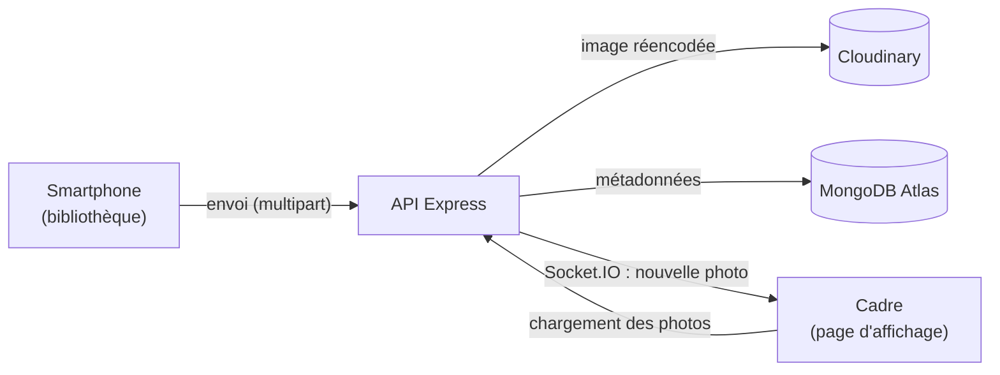

# Architecture

Comment FamilyFrame est construit. Pour lancer le projet : [`README.md`](README.md). Pour y contribuer : [`CONTRIBUTING.md`](CONTRIBUTING.md).

## Vue d'ensemble

Trois pages React (connexion, bibliothèque, cadre) servies par le même client Vite, une API Express qui porte aussi le serveur Socket.IO. Les images sont stockées sur Cloudinary ; MongoDB ne garde que les métadonnées.

## Organisation du dépôt

Monorepo **pnpm workspaces** : un lockfile unique, des scripts racine qui orchestrent les deux packages (`pnpm -r`).

- `client/` : les pages React (connexion, bibliothèque, cadre), servies par Vite.
- `server/` : l'API Express, le serveur Socket.IO et l'accès aux données (Prisma).
- `docs/` : énoncé du brief et docs de travail datés.

Le détail des fichiers n'est pas listé ici : il change trop vite pour rester juste.

## Parcours d'une photo

1. Le proche, connecté à son compte, prend ou choisit une photo (`<input type="file" accept="image/*" capture>`).
2. Le client envoie l'image en `multipart/form-data` à une route Express ; **Multer** la reçoit en mémoire.
3. Le serveur vérifie la session (cookie `ff_session`, voir [Authentification](#authentification)) et le fichier (10 Mo max, JPEG/PNG/WebP), calcule le **SHA-256** des octets reçus et refuse un fichier déjà présent dans la bibliothèque du compte (`409 PHOTO_DUPLICATE`, sans appeler Sharp ni Cloudinary), puis le **décode et le réencode avec Sharp** : JPEG de 1920 px max, orientation EXIF appliquée, métadonnées (GPS compris) supprimées. Le type déclaré par le navigateur n'est pas fiable : c'est le décodage par Sharp qui valide vraiment l'image.
4. L'image réencodée est envoyée à **Cloudinary**, dans le dossier `familyframe`.
5. **Prisma** enregistre dans MongoDB l'URL, l'identifiant Cloudinary, le propriétaire (`ownerId`, le compte connecté), le SHA-256 du fichier reçu et la date. L'index unique `(ownerId, sha256)` est la vraie garantie : deux envois simultanés du même fichier passent la vérification, le second est refusé à l'enregistrement (`409` aussi) et son image Cloudinary est détruite.
6. Le serveur émet un événement **Socket.IO** vers les connexions de ce compte ; son cadre affiche la nouvelle photo sans rechargement.
7. À l'affichage, le serveur construit deux URL Cloudinary depuis l'identifiant : la photo entière et une miniature carrée de 640 px recadrée sur le sujet (`c_fill,g_auto`). Les deux portent `f_auto,q_auto` : Cloudinary livre du WebP si le navigateur l'accepte et que c'est plus léger, sinon du JPEG. Une seule image est stockée. Les URL sont **signées** et le compte Cloudinary a « Strict transformations » activé : une URL dont on modifie la transformation est refusée, personne ne peut consommer le quota à notre place.

## Pages

| Chemin               | Page                                                                                                                                                                                                                                                                                                                 |
| -------------------- | -------------------------------------------------------------------------------------------------------------------------------------------------------------------------------------------------------------------------------------------------------------------------------------------------------------------- |
| `/login`             | connexion : e-mail et mot de passe ; renvoie ensuite vers la page demandée                                                                                                                                                                                                                                           |
| `/invite/:token`     | invitation (publique) : « Rejoindre FamilyFrame », choix du nom et du mot de passe (saisi deux fois, il n'y a pas de réinitialisation), puis la bibliothèque, connecté ; déjà connecté, une carte propose de se déconnecter d'abord                                                                                  |
| `/`                  | bibliothèque : carte d'envoi (« Prendre une photo » ou « Choisir une image »), puis les photos du compte en vignettes ou en liste (même choix mémorisé que le cadre), 30 par page avec « Charger plus » ; une photo s'ouvre en grand dans un nouvel onglet ; « Invitations » (admin seulement) et « Se déconnecter » |
| `/frame`             | cadre : toute la bibliothèque du compte connecté (toutes les pages, 100 photos par requête), en vignettes ou en liste (choix mémorisé par appareil), chacune avec « Supprimer » ; « Lancer le diaporama » ou une minute sans activité lance le diaporama                                                             |
| `/admin/invitations` | invitations (admin) : un e-mail donne un lien à transmettre soi-même, affiché une seule fois avec « Copier le lien » ; liste des invitations avec leur état (« En attente », « Utilisée », « Expirée »)                                                                                                              |

`/`, `/frame` et `/admin/invitations` sont enveloppées dans `RequireAuth` (`client/src/auth/`, une route parente dans `App.tsx`) : sans utilisateur, redirection vers `/login` en gardant la page demandée. `/admin/invitations` passe aussi par `RequireAdmin`, qui montre à un membre une carte « Cette page est réservée à l'administrateur. » plutôt qu'une redirection muette ; le `403` du serveur reste la vraie protection. `AuthProvider` appelle `GET /api/auth/me` au chargement (le cookie est `httpOnly`, seul le serveur sait qui est connecté) et oublie l'utilisateur quand l'API répond 401 ou que Socket.IO refuse la connexion (`UNAUTHENTICATED`). Seul un 401 renvoie vers `/login` : si l'API est injoignable au démarrage (erreur réseau ou 5xx, par exemple un cadre rallumé avant le Wi-Fi), `AuthProvider` reste en chargement et réessaie toutes les 5 secondes. Le cadre recharge ses photos une fois par jour : cet appel HTTP prolonge la session (voir [Authentification](#authentification)). Limite connue : le jeton d'invitation est dans l'URL de `/invite/:token`, donc dans l'historique du navigateur de la personne invitée ; acceptable pour un lien qui sert une fois et pendant 7 jours.

Le routage est fait côté navigateur (`react-router`). En production (J2), le serveur qui sert le client devra donc renvoyer `index.html` pour `/login`, `/frame`, `/invite/:token` et `/admin/invitations` (« SPA fallback »), sinon un rechargement de la page donne une 404. Un serveur statique qui journalise les chemins écrirait aussi le jeton des liens d'invitation : à régler en J2 en choisissant son format de logs.

## API

| Route                                   | Réponse                                                                                                                                                                                                            |
| --------------------------------------- | ------------------------------------------------------------------------------------------------------------------------------------------------------------------------------------------------------------------ |
| `GET /api/health`                       | `200 { "status": "ok" }` (servira de healthcheck Docker en J2)                                                                                                                                                     |
| `POST /api/auth/login`                  | JSON `{ email, password }` → `200 { user }` + cookie `ff_session`                                                                                                                                                  |
| `POST /api/auth/logout`                 | `204` ; supprime la session et efface le cookie (répond `204` aussi sans session)                                                                                                                                  |
| `GET /api/auth/me`                      | `200 { user }`, l'utilisateur de la session                                                                                                                                                                        |
| `POST /api/invitations`                 | JSON `{ email }` → `201 { invitation, token }` : réservé à l'admin ; le jeton brut n'est envoyé qu'une fois, le client en fait le lien                                                                             |
| `GET /api/invitations`                  | `200 { invitations }` : réservé à l'admin ; toutes les invitations, la plus récente en premier                                                                                                                     |
| `POST /api/invitations/accept`          | JSON `{ token, displayName, password }` → `201 { user }` + cookie `ff_session` : public ; crée un compte `member` à l'e-mail de l'invitation et le connecte                                                        |
| `GET /api/friendships`                  | `200 { friends, incoming, outgoing }` : amis, demandes reçues et demandes envoyées du compte connecté, la plus récente en premier                                                                                  |
| `POST /api/friendships`                 | JSON `{ email }` → `201 { friendship }` : demande d'ami à l'e-mail exact d'un compte existant ; `200 { friendship }` si sa demande m'attendait (acceptée)                                                          |
| `POST /api/friendships/:id/accept`      | `200 { friendship }` : le destinataire d'une demande en attente l'accepte ; l'amitié devient mutuelle                                                                                                              |
| `DELETE /api/friendships/:id`           | `204` sans corps, pour l'un ou l'autre côté : refuse une demande reçue, annule une demande envoyée ou retire un ami                                                                                                |
| `GET /api/photos?cursor=<id>&limit=<n>` | `200 { photos, nextCursor }` : photos du compte connecté, la plus récente en premier ; `limit` de 1 à 100 (30 par défaut) ; `nextCursor` est l'id à passer en `cursor` pour la page suivante, `null` à la dernière |
| `POST /api/photos`                      | `multipart/form-data` avec `photo` (fichier) → `201 Photo`                                                                                                                                                         |
| `DELETE /api/photos/:id`                | `204` sans corps, pour une photo du compte connecté ; supprime l'enregistrement, puis l'image Cloudinary (cache CDN compris) si plus aucune photo n'y renvoie                                                      |

Toutes les routes `/api/photos`, `/api/friendships`, `GET /api/auth/me` et les routes admin de `/api/invitations` demandent une session ; sans elle : `401 UNAUTHENTICATED`. Les routes admin répondent `403 FORBIDDEN` à un membre. Un `user` vaut `{ id, email, displayName, role }` (`role` : `member` ou `admin`), jamais le hash du mot de passe.

Une `Invitation` vaut `{ id, email, status, createdAt, expiresAt }` (dates en ISO 8601) ; `status` vaut `pending` (en attente), `used` (utilisée) ou `expired` (expirée), calculé à chaque lecture. Le hash du jeton et l'admin qui l'a créée restent côté serveur.

Une `Friendship` vaut `{ id, user, createdAt }` (`createdAt` en ISO 8601) : `id` est celui de l'amitié (c'est lui qu'on accepte ou supprime), `user` l'autre compte, `{ id, displayName, email }`, jamais son rôle ni le hash de son mot de passe. Une demande vise l'e-mail exact d'un compte (même normalisation qu'au login) ; ma demande en attente bloque une nouvelle demande ; demander quelqu'un dont la demande m'attend l'accepte, par la même écriture que le bouton (voir [la demande croisée](docs/superpowers/specs/2026-11-24-friends-cross-request.md)). Refuser, annuler et retirer sont la même suppression, permise aux deux côtés : seul le log les distingue. Accepter est une seule écriture filtrée sur `{ id, addresseeId, status: 'pending' }` : seul le destinataire accepte, sans course entre lecture et écriture. L'admin est ici un membre comme un autre.

Une `Photo` vaut `{ id, url, thumbnailUrl, createdAt }` (`createdAt` en ISO 8601). Chaque photo appartient au compte qui l'a envoyée (`ownerId`, côté serveur seulement) : la liste, la suppression et les événements ne concernent que les photos du compte connecté. L'identifiant Cloudinary reste côté serveur : le client reçoit des URL prêtes à l'emploi.

La liste est paginée par curseur (_keyset_) sur l'id : un ObjectId commence par sa date de création, trier par id revient donc à trier par date, et `id < cursor` est une seule requête sur l'index `(ownerId, id)`. Une photo ajoutée ou supprimée entre deux pages ne décale rien, contrairement à une pagination par numéro de page.

En cas d'erreur, l'API renvoie `{ "error": code }` ; le client traduit le code en message français :

| Cas                                                                                                                        | Statut | `error`                 |
| -------------------------------------------------------------------------------------------------------------------------- | ------ | ----------------------- |
| aucun fichier                                                                                                              | 400    | `PHOTO_MISSING`         |
| autre erreur Multer (mauvais champ, plusieurs fichiers)                                                                    | 400    | `UPLOAD_INVALID`        |
| corps JSON illisible (routes `/api/auth`, `/api/invitations` et `/api/friendships`)                                        | 400    | `BODY_INVALID`          |
| e-mail absent ou mal formé (création d'invitation, demande d'ami)                                                          | 400    | `EMAIL_INVALID`         |
| nom d'affichage vide après trim, de plus de 50 caractères, ou absent                                                       | 400    | `DISPLAY_NAME_INVALID`  |
| mot de passe de moins de 12 ou plus de 128 caractères, ou absent                                                           | 400    | `PASSWORD_INVALID`      |
| demande d'ami à sa propre adresse                                                                                          | 400    | `SELF_FRIEND`           |
| `limit` ou `cursor` invalide (`GET /api/photos`)                                                                           | 400    | `QUERY_INVALID`         |
| pas de session, session inconnue ou expirée                                                                                | 401    | `UNAUTHENTICATED`       |
| e-mail inconnu ou mauvais mot de passe                                                                                     | 401    | `INVALID_CREDENTIALS`   |
| compte connecté sans le rôle demandé (membre sur une route admin)                                                          | 403    | `FORBIDDEN`             |
| route inconnue                                                                                                             | 404    | `ROUTE_NOT_FOUND`       |
| photo inconnue, photo d'un autre compte, ou id qui n'est pas un ObjectId                                                   | 404    | `PHOTO_NOT_FOUND`       |
| jeton d'invitation inconnu, remplacé ou mal formé                                                                          | 404    | `INVITATION_NOT_FOUND`  |
| demande d'ami à un e-mail sans compte                                                                                      | 404    | `USER_NOT_FOUND`        |
| amitié ou demande inconnue, d'autres comptes, déjà supprimée, déjà acceptée (acceptation), ou id qui n'est pas un ObjectId | 404    | `FRIENDSHIP_NOT_FOUND`  |
| fichier déjà dans la bibliothèque du compte (même SHA-256)                                                                 | 409    | `PHOTO_DUPLICATE`       |
| l'e-mail a déjà un compte (création d'invitation, ou acceptation après une course)                                         | 409    | `ACCOUNT_EXISTS`        |
| demande d'ami entre deux comptes déjà amis                                                                                 | 409    | `ALREADY_FRIENDS`       |
| demande d'ami alors que ma demande attend déjà, ou que la sienne a disparu avant l'acceptation                             | 409    | `FRIEND_REQUEST_EXISTS` |
| invitation de plus de 7 jours                                                                                              | 410    | `INVITATION_EXPIRED`    |
| invitation déjà utilisée                                                                                                   | 410    | `INVITATION_USED`       |
| fichier de plus de 10 Mo                                                                                                   | 413    | `PHOTO_TOO_LARGE`       |
| type autre que JPEG, PNG ou WebP                                                                                           | 415    | `FORMAT_UNSUPPORTED`    |
| image illisible par Sharp                                                                                                  | 422    | `IMAGE_UNREADABLE`      |
| toute autre erreur (Cloudinary, base)                                                                                      | 500    | `SERVER_ERROR`          |

## Authentification

- **Comptes** : `User` (e-mail unique, nom d'affichage, hash du mot de passe, rôle `member` ou `admin`). Mots de passe hachés en **argon2id** (`server/src/lib/password.ts`, seul fichier qui importe `argon2`). Pas d'inscription libre : en dehors des deux comptes du seed (`pnpm db:seed`), un compte naît d'une invitation, toujours avec le rôle `member`.
- **Session** : à la connexion ou à l'acceptation d'une invitation, le serveur tire 32 octets aléatoires (le jeton), les envoie dans le cookie `ff_session` et ne garde en base que leur SHA-256 (`Session.tokenHash`) : une fuite de la base n'ouvre aucune session. La déconnexion supprime la session : révocation immédiate, sans liste noire.
- **Cookie** : `httpOnly` (illisible en JavaScript), `SameSite=Lax`, `Secure` quand `NODE_ENV=production`, `path=/`, expire avec la session. En dev, le proxy Vite rend l'API same-origin : le navigateur envoie le cookie sans réglage CORS.
- **Glissement** : une session dure 90 jours ; une requête HTTP authentifiée qui arrive à moins de 45 jours de la fin la prolonge à 90 jours et renvoie le cookie. Le cadre recharge ses photos une fois par jour (`usePhotoFeed`) : cet appel HTTP prolonge la session, ce que la connexion Socket.IO ne ferait pas. Un cadre allumé ne se déconnecte donc jamais, pour au plus une écriture en base tous les 45 jours. Une socket déjà ouverte n'est pas revérifiée par le serveur quand sa session expire ou est supprimée par une déconnexion : elle est refusée à la reconnexion suivante.
- **Expiration** : Prisma 6 ne sait pas déclarer d'index TTL MongoDB. Une session expirée est supprimée quand on la lit, et toutes les sessions expirées à chaque session ouverte (connexion, invitation).
- **Connexion refusée** : e-mail inconnu et mauvais mot de passe répondent tous deux `401 INVALID_CREDENTIALS`, et un e-mail inconnu coûte quand même une vérification argon2 (contre un hash factice) : ni le message ni le temps de réponse ne disent qui a un compte.
- **Garde HTTP** : `requireAuth` (`features/auth/auth.middleware.ts`) lit le cookie avec `lib/session-token.ts` (sans `cookie-parser`), valide la session et pose `req.user`, typé par _declaration merging_ sur `Request` ; `currentUser(req)` (`features/auth/auth.guard.ts`) le relit sans cast. `requireRole(role)` (même fichier), monté après `requireAuth`, compare le rôle de la session déjà chargée (aucune requête en plus) et répond `403 FORBIDDEN` à un autre rôle. Il vit à part du middleware : `auth.middleware.ts` atteint `config.ts`, qu'un test unitaire ne peut pas charger sans variables d'environnement. `/api/photos`, `/api/auth/me`, `/api/friendships` et les routes admin de `/api/invitations` (puis `requireRole('admin')`) sont derrière `requireAuth` ; `/api/health`, `/api/auth/login`, `/api/auth/logout` et `/api/invitations/accept` restent publics.
- **Invitations** : l'admin crée un lien depuis `/admin/invitations`. Le jeton suit la règle des sessions (32 octets aléatoires, `lib/session-token.ts`, seul son SHA-256 en base dans `Invitation.tokenHash`), vaut 7 jours (`INVITATION_DURATION_MS`) et sert une fois (`usedAt`). Le serveur renvoie le jeton brut une seule fois ; le client construit le lien `` `${window.location.origin}/invite/${token}` `` : l'origine que l'admin utilise est celle que la famille atteint, sans variable de configuration en plus. Une nouvelle invitation pour le même e-mail **remplace** les précédentes non utilisées (supprimées) : « j'ai perdu le lien » se règle sans bouton de révocation, et l'ancien lien répond `404 INVITATION_NOT_FOUND`. Le jeton ne passe jamais dans un chemin d'API (`http.request` journalise les chemins) : il voyage dans le corps JSON. L'acceptation (`POST /api/invitations/accept`, publique) vérifie d'abord le jeton (forme, existence, déjà utilisé, expiré), puis le nom, puis le mot de passe : inutile de choisir un mot de passe pour un lien mort. Elle crée le compte, puis marque l'invitation utilisée, sans transaction : l'index unique sur `User.email` garantit qu'un double envoi ne crée qu'un compte (l'autre reçoit `409 ACCOUNT_EXISTS`). Limite connue : si l'admin réinvite la même adresse pendant une acceptation, le compte peut être créé alors que la réponse est une `500` ; le compte fonctionne, la personne se connecte sur `/login`. La session est ouverte par `openSession` du service d'auth (aussi utilisé par la connexion), et le contrôleur pose le cookie comme au login.
- **JSON** : `express.json()` n'est monté que sur `/api/auth`, `/api/invitations` et `/api/friendships`, les seules routes qui lisent du JSON ; un corps illisible répond `400 BODY_INVALID`.

## Temps réel

- **Connexion protégée** : un middleware `io.use` (`features/auth/auth.socket.ts`) lit le même cookie dans la requête de handshake et valide la session, sans glissement (pas de réponse HTTP pour porter un nouveau cookie). Sans session valide, la connexion est refusée avec l'erreur `UNAUTHENTICATED`, que le client traite comme une déconnexion ; une panne de la base donne `SERVER_ERROR` (journalisée en `server.error`). Chaque socket rejoint la room `user:<id>` (`userRoom`, même fichier).
- Deux événements, du serveur vers les connexions du propriétaire de la photo (`io.to(userRoom(ownerId))`) : `photo:new` avec la `Photo` créée, `photo:deleted` avec l'id de la photo supprimée. Les autres comptes ne les reçoivent pas.
- Le cadre recharge toute la bibliothèque (toutes les pages) à chaque connexion Socket.IO, reconnexions comprises : une photo envoyée pendant une coupure n'est pas perdue. Ensuite il ajoute `photo:new` en tête et retire `photo:deleted` de la liste, sans recharger. Les événements reçus pendant un chargement sont rejoués sur la liste chargée, et seul le dernier chargement lancé s'applique. Limite connue : chaque connexion relit toutes les pages et le diaporama crée une diapositive par photo, ce qui convient à quelques centaines de photos. La page bibliothèque (`/`) recharge sa première page à chaque connexion et suit les mêmes événements (`usePhotoLibrary`, socket partagée dans `client/src/photoSocket.ts`).
- Les amitiés ne sont pas poussées : la page `/friends` recharge ses listes à l'ouverture et après chaque action. Les demandes sont rares et la page est ouverte exprès ; un événement Socket.IO demanderait un type d'événement, un écouteur côté client et `io` dans un quatrième contrôleur.
- Les types partagés (`Photo`, codes d'erreur, événements) sont dupliqués entre `server/src/types.ts` et `client/src` : un package commun compliquerait les builds Docker.

## Serveur : app et processus

- `server/src/app.ts` construit l'application Express (middlewares, routes, gestion d'erreurs) sans écouter de port.
- `server/src/server.ts` la fait tourner : serveur HTTP, Socket.IO, port. Socket.IO est créé d'abord puis rattaché au serveur HTTP, car le contrôleur en a besoin pour diffuser.
- **Au démarrage**, un `ping` MongoDB : une base injoignable arrête le serveur tout de suite, au lieu d'échouer à la première requête.
- **À l'arrêt** (`SIGINT` au Ctrl+C, `SIGTERM` au `docker stop`) : fermeture de Socket.IO et du serveur HTTP, puis déconnexion de Prisma.

## Couches du backend

Une feature par dossier (`server/src/features/photos/`, `server/src/features/auth/`, `server/src/features/invitations/`, `server/src/features/friendships/`), un fichier par couche. Pour les photos :

| Fichier                | Rôle                                                                                                                       |
| ---------------------- | -------------------------------------------------------------------------------------------------------------------------- |
| `photos.routes.ts`     | chemins et middleware d'upload, rien d'autre                                                                               |
| `photos.upload.ts`     | configuration Multer : en mémoire, 10 Mo, un fichier                                                                       |
| `photos.controller.ts` | lit la requête et le compte connecté, appelle le service, convertit en DTO, diffuse à la room du propriétaire, répond      |
| `photos.service.ts`    | règles métier (fichier, format, doublon, image lisible, propriétaire, image encore utilisée) ; ignore Express et Socket.IO |
| `photos.repository.ts` | seul accès à Prisma                                                                                                        |

- `features/auth/` suit le même découpage (`auth.repository.ts`, `auth.service.ts`, `auth.controller.ts`, `auth.routes.ts`), plus `auth.middleware.ts` (garde HTTP), `auth.guard.ts` (`currentUser`, `requireRole`), `auth.socket.ts` (garde Socket.IO) et `auth.cookie.ts` (pose et efface le cookie). Le service d'auth reçoit ses dépendances (`repository`, `hashToken`, `generateToken`, `verifyPassword`, `now`, `logger`) ; `app.ts` l'assemble une fois (`assembleAuthService`) et `server.ts` le partage avec Socket.IO.
- `features/invitations/` suit le même découpage (`invitations.repository.ts`, `invitations.service.ts`, `invitations.controller.ts`, `invitations.routes.ts`). Le service reçoit `repository` (seul endroit qui crée un compte), `generateToken`, `hashToken`, `hashPassword`, `now` et `logger` ; le contrôleur reçoit aussi le service d'auth pour `openSession` ; `app.ts` construit `requireAdmin = requireRole('admin')` une fois et le passe au routeur, derrière `requireAuth`.
- `features/friendships/` suit le même découpage (`friendships.repository.ts`, `friendships.service.ts`, `friendships.controller.ts`, `friendships.routes.ts`). Le service reçoit `repository` et `logger` ; le repository calcule `pairKey` et ne lit des comptes que `id`, `email` et `displayName`. `app.ts` monte le routeur derrière `requireAuth`, comme les photos. Le service expose aussi `areFriends(userId, otherUserId)` : l'étape 5 le recevra en dépendance, la règle « amis = ligne acceptée » reste ici.
- Les dépendances sont passées par des fonctions-fabriques (`createPhotosService({ repository, toFrameJpeg, uploadImage, deleteImage, logger })`), assemblées dans `app.ts` : un test peut fournir de fausses implémentations.
- `server/src/lib/` regroupe les clients techniques : Prisma (`db.ts`), Cloudinary, sharp (`image.ts`), et `email.ts` (`parseEmail`, la même règle pour une invitation et une demande d'ami).
- **Erreurs** : le service lève une `AppError` portant un code ; le contrôleur n'a pas de try/catch (Express 5 transmet les rejets). Une route inconnue tombe sur `errors/not-found.ts` (monté après les routes), qui lève `ROUTE_NOT_FOUND`. `errors/error-handler.ts` est le seul endroit qui écrit une réponse d'erreur, avec un statut tiré d'un `Record` exhaustif sur les codes. Une erreur de sharp devient `IMAGE_UNREADABLE` (faute de l'utilisateur) ; une erreur de Cloudinary ou de Prisma reste une 500.

## Logs

- Le serveur écrit **une ligne par événement sur la sortie standard**, via `server/src/lib/logger.ts` (fait maison, sans dépendance). C'est ce que `docker logs` affiche.
- **Format** : JSON par défaut, filtrable (`{"time":"…","level":"info","event":"photo.created","photoId":"…"}`) ; `LOG_FORMAT=pretty` en dev donne `14:37:17 INFO  photo.created photoId=…`. Une `Error` est écrite avec son nom, son message et sa pile.
- **Niveaux** : `info` < `warn` < `error` ; `LOG_LEVEL` fixe le niveau minimum écrit.
- **Noms d'événements stables** `domaine.action` : on filtre sur le nom (`docker logs <conteneur> | grep photo.`), pas sur un texte qui change à chaque reformulation.
- **Pas de données personnelles** : jamais un nom, l'e-mail, le mot de passe ni le jeton de session ; seulement des identifiants (`photoId`, `cloudinaryId`, `socketId`, `userId`, `friendshipId`) ; les chemins sans leur query string.
- Le service photos reçoit le logger par injection ; le reste du serveur importe `logger`.

| Événement                                                             | Niveau                        | Écrit par                                                                                                                                                                         |
| --------------------------------------------------------------------- | ----------------------------- | --------------------------------------------------------------------------------------------------------------------------------------------------------------------------------- |
| `db.connected` / `db.unreachable`                                     | info / error                  | `server.ts`, ping au démarrage                                                                                                                                                    |
| `server.started`                                                      | info                          | `server.ts`                                                                                                                                                                       |
| `socket.connected` / `socket.disconnected`                            | info                          | `server.ts`, avec `userId`                                                                                                                                                        |
| `auth.login_succeeded` / `auth.logged_out`                            | info                          | service auth, avec `userId`                                                                                                                                                       |
| `auth.login_failed`                                                   | warn                          | service auth, sans aucune donnée (jamais l'e-mail)                                                                                                                                |
| `auth.forbidden`                                                      | warn                          | `requireRole`, avec `userId` : un compte sans le rôle demandé                                                                                                                     |
| `seed.done` / `seed.refused`                                          | info / error                  | `prisma/seed.ts` : nombre de comptes créés / refus avec `NODE_ENV=production`                                                                                                     |
| `http.request`                                                        | info, warn (4xx), error (5xx) | `lib/request-logger.ts`, sauf `/api/health`                                                                                                                                       |
| `photo.created` / `photo.deleted`                                     | info                          | service photos, avec `userId` (le propriétaire) ; `photo.deleted` dit aussi si l'image Cloudinary a été détruite (`isImageDestroyed`)                                             |
| `photo.duplicate`                                                     | info                          | service photos : fichier déjà dans la bibliothèque, avec `userId` et le `photoId` de la photo existante (ou le `cloudinaryId` de l'image détruite après un envoi simultané)       |
| `photo.unreadable`                                                    | warn                          | service photos, erreur de sharp                                                                                                                                                   |
| `photo.orphaned`                                                      | error                         | service photos : image sur Cloudinary sans enregistrement en base (échec d'enregistrement ou de suppression)                                                                      |
| `invitation.created`                                                  | info                          | service invitations, avec `invitationId`, `userId` (l'admin) et `replacedCount` (invitations remplacées) ; jamais l'e-mail ni le jeton                                            |
| `invitation.accepted`                                                 | info                          | service invitations, avec `invitationId` et `userId` (le nouveau membre)                                                                                                          |
| `invitation.accept_failed`                                            | warn                          | service invitations, avec `reason` (`not_found`, `used`, `expired`, `account_exists`) et `invitationId` quand il est connu ; jamais le jeton, l'e-mail, le nom ni le mot de passe |
| `friendship.requested` / `friendship.accepted` / `friendship.deleted` | info                          | service amis, avec `friendshipId` et `userId` (qui agit) ; `friendship.deleted` dit aussi ce qui s'est passé (`reason` : `removed`, `cancelled`, `refused`)                       |
| `friendship.request_failed`                                           | warn                          | service amis, avec `reason` (`user_not_found`, `self`, `already_friends`, `request_exists`) et `userId` ; jamais l'e-mail                                                         |
| `server.error`                                                        | error                         | `errors/error-handler.ts` (chaque 500), `auth.socket.ts` (handshake)                                                                                                              |
| `server.stopping` / `server.stopped` / `server.stop_failed`           | info / info / error           | `server.ts`, à l'arrêt                                                                                                                                                            |
| `process.crashed`                                                     | error                         | `server.ts`, exception ou rejet non géré, puis arrêt                                                                                                                              |

## Réseau en développement

| Service       | Port | Rôle                                                 |
| ------------- | ---- | ---------------------------------------------------- |
| Client (Vite) | 5180 | pages React, proxy `/api` et `/socket.io` vers l'API |
| API (Express) | 3000 | routes REST + serveur Socket.IO                      |

- **Proxy Vite** : le navigateur ne parle qu'à l'origine du client, ce qui évite les problèmes de CORS et d'URL d'API en dur. Le WebSocket passe aussi par le proxy (`ws: true`).
- **Accès LAN** : Vite écoute sur toutes les interfaces (`host: true`) pour tester depuis un smartphone sur le même réseau.
- **Port 5180 en `strictPort`** : échoue franchement si le port est pris, au lieu de basculer en silence sur un autre.
- **CORS** côté API restreint à `CLIENT_ORIGIN`, pour les appels qui ne passeraient pas par le proxy.

## Configuration

- Variables d'environnement lues dans `server/src/config.ts`, qui **échoue au démarrage** si une variable obligatoire manque : `DATABASE_URL`, `CLOUDINARY_CLOUD_NAME`, `CLOUDINARY_API_KEY`, `CLOUDINARY_API_SECRET`.
- `LOG_LEVEL` (`info`, `warn`, `error` ; défaut `info`) et `LOG_FORMAT` (`json`, `pretty` ; défaut `json`) sont facultatives et lues dans `server/src/lib/logger.ts`, pas dans `config.ts` : les tests importent le logger sans fournir les secrets. Une valeur inconnue empêche le démarrage.
- En local, `server/.env` (non versionné) est chargé par Node (`--env-file-if-exists`) ; la liste des variables attendues est dans `server/.env.example`.
- `NODE_ENV=production` ajoute `Secure` au cookie de session (`config.isProduction`) et interdit le seed.
- Côté client, aucun secret : le client n'appelle que des chemins relatifs.

## Données

- **MongoDB Atlas** via **Prisma 6**. Prisma 7+ ne supporte pas encore MongoDB : la version est volontairement figée.
- Le client Prisma est généré à l'installation (`postinstall`) ; le schéma est poussé avec `pnpm --filter server db:push` (pas de migrations avec MongoDB).
- Collections `User`, `Session`, `Photo`, `Invitation` et `Friendship`. Index uniques sur `User.email`, `Session.tokenHash`, `Invitation.tokenHash` et `Friendship.pairKey` ; le rôle est un `enum Role` Prisma et l'état d'une amitié un `enum FriendshipStatus` (`pending`, `accepted`), que Prisma génère en unions de chaînes. `Photo.ownerId` relie chaque photo à son compte ; index unique `(ownerId, sha256)` (un même fichier n'entre qu'une fois dans une bibliothèque), index `(ownerId, id)` pour la liste d'un compte, et index simple sur `cloudinaryId` (plus unique : à l'étape 5, un partage pointera vers la même image). `Invitation.invitedById` relie une invitation à l'admin qui l'a créée ; index simple sur `Invitation.email` (pas unique : une invitation utilisée reste à côté d'une plus récente pour la même adresse). `pnpm db:seed` (`server/prisma/seed.ts`) vide la base (sessions, photos, invitations et amitiés avant les comptes, car Prisma émule les relations sur MongoDB) et crée les deux comptes de test du README.
- **Amitiés** : un seul document `Friendship` par paire de comptes porte la demande, puis l'amitié (`requesterId`, `addresseeId`, `status`). `pairKey` vaut les deux ids triés et joints par `:`, sous un index unique : MongoDB ne sait pas indexer « cette paire, dans un sens ou dans l'autre », et la clé triée fait refuser par l'index lui-même A→B à côté de B→A, demandes simultanées comprises. Seul le repository calcule `pairKey`. Index simples sur `requesterId` et `addresseeId` pour la liste d'un compte. Une demande refusée ou annulée, comme une amitié retirée, est supprimée : pas de troisième état.
- Quand `Photo` gagne un champ obligatoire ou un index unique, `pnpm db:seed` passe **avant** `pnpm db:push` : MongoDB compte un champ absent comme `null`, et d'anciennes photos sans ce champ empêcheraient l'index unique de se créer.
- Piège MongoDB : Prisma n'écrit pas un champ facultatif absent du `create`, et `where: { usedAt: null }` ne trouve qu'un `null` enregistré, pas un champ absent. Le repository des invitations écrit donc `usedAt: null` explicitement à la création : le filtre « pas encore utilisée » reste un simple `usedAt: null`.

## Outillage

- **TypeScript** partout : `tsx watch` en dev côté serveur, `tsc -p tsconfig.build.json` pour le build (sans les tests) ; `tsc -b` + Vite côté client.
- **Biome** : lint, formatage et tri des imports (remplace ESLint + Prettier). Dans `server/src`, `noConsole` interdit `console` : on passe par le logger.
- **lefthook** : `biome check` au pre-commit, **commitlint** au commit-msg.
- **Vitest** : tests unitaires du serveur, colocalisés (`*.test.ts`), lancés par `pnpm test` sans API ; exclus du build par `server/tsconfig.build.json`.
- **Bruno** (`server/bruno/`) : requêtes de l'API avec assertions, un dossier par endpoint, des fichiers `NN-nominal-…` / `NN-edge-…`. Lancées par `pnpm test:bruno` contre l'API démarrée et la base remplie par le seed (CLI via `pnpm dlx`, version figée, pas de dépendance). Le dossier `auth/` passe en premier (`seq: 1`) et range le cookie de session dans une variable, envoyée à toutes les requêtes par un en-tête de collection ; le CLI tourne avec `--disable-cookies` pour que sa boîte à cookies ne renvoie pas la session aux requêtes « sans cookie ». Un second compte (l'admin, `auth/login/05`) range son cookie dans `adminCookie` : les requêtes qui vérifient qu'un compte ne touche pas aux photos d'un autre l'envoient à la place de celui du membre. Le dossier `invitations/` passe juste après (`seq: 2`) : l'admin y crée une invitation pour une adresse neuve à chaque lancement (`invite-<horodatage>@familyframe.test`), donc rien à remettre à zéro entre deux lancements. Le dossier `friendships/` suit (`seq: 3`) : le membre y envoie une demande à l'admin, et `invitations/accept/05` range le cookie du compte créé dans `inviteeCookie`, un tiers qui ne doit toucher à aucune amitié. Le dossier finit sans amitié entre le membre et l'admin ; `create/01` efface d'abord celle d'un lancement interrompu.
- **Hooks Claude Code** (`.claude/hooks/`) : garde-fous pour l'agent IA, testés avec `node:test`.

## Conteneurisation

À venir (J2–J4) : images Docker du client et de l'API, orchestration Docker Compose, gestion des secrets.

Points déjà connus :

- **Sharp** embarque des binaires propres à chaque plateforme : il doit être installé dans l'image, jamais copié depuis le `node_modules` Windows.
- **argon2** charge un binaire précompilé livré dans le paquet (Linux x64/arm64, glibc et musl, Windows x64) : son script de build reste bloqué par pnpm (`ignoredBuiltDependencies`). Comme Sharp, il doit être installé dans l'image, jamais copié depuis le `node_modules` Windows.
- Le serveur qui sert le client doit faire le **SPA fallback** pour `/login`, `/frame`, `/invite/:token` et `/admin/invitations` (voir [Pages](#pages)).
- Avec `NODE_ENV=production`, le cookie de session est `Secure` : servi en http simple (cadre sur le réseau local, Compose en local), le navigateur l'ignore et la connexion échoue sans message. Servir en HTTPS, ou ne pas définir `NODE_ENV=production` en http.
