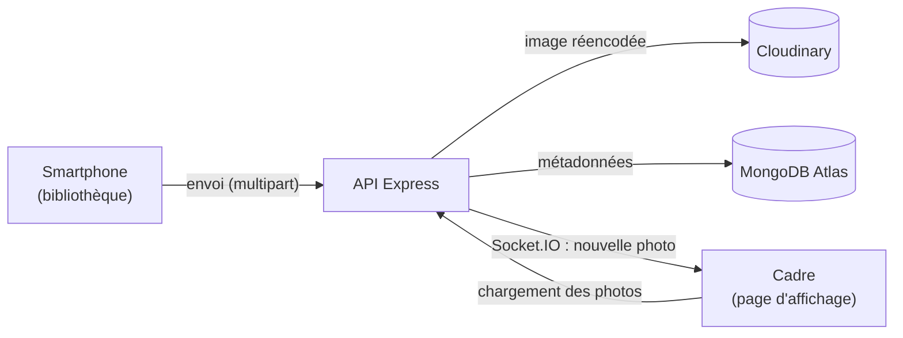

# Architecture

Comment FamilyFrame est construit. Pour lancer le projet : [`README.md`](README.md). Pour y contribuer : [`CONTRIBUTING.md`](CONTRIBUTING.md).

## Vue d'ensemble

Trois pages React (connexion, bibliothèque, cadre) servies par le même client Vite, une API Express qui porte aussi le serveur Socket.IO. Les images sont stockées sur Cloudinary ; MongoDB ne garde que les métadonnées.

## Organisation du dépôt

Monorepo **pnpm workspaces** : un lockfile unique, des scripts racine qui orchestrent les deux packages (`pnpm -r`).

- `client/` : les pages React (connexion, bibliothèque, cadre), servies par Vite.
- `server/` : l'API Express, le serveur Socket.IO et l'accès aux données (Prisma).
- `docs/` : énoncé du brief et docs de travail datés.

Le détail des fichiers n'est pas listé ici : il change trop vite pour rester juste.

## Parcours d'une photo

1. Le proche, connecté à son compte, prend une photo (`<input type="file" accept="image/jpeg,image/png,image/webp" capture="environment">`) ou en choisit jusqu'à 20 (même `accept`, `multiple`).
2. Le client envoie l'image en `multipart/form-data` à une route Express ; **Multer** la reçoit en mémoire. L'envoi passe par `XMLHttpRequest` plutôt que `fetch` : seul `upload.onprogress` donne la progression, affichée sur une vignette grisée en tête de la bibliothèque. Les photos partent une par une, dans une file d'attente côté client (`upload/uploadQueue.ts`) tenue par `UploadsProvider`, monté au-dessus des routes comme `CollectionsProvider` : quitter la bibliothèque n'arrête pas la file et ses vignettes reviennent au retour. La page ouverte reçoit chaque photo envoyée par un écouteur (`usePhotoUploads`) ; le rangement dans une collection se fait dans la file, page ouverte ou non. Juste avant l'envoi, une photo de plus de 4096 px sur son grand côté ou de plus de 10 Mo est redessinée dans un `canvas` à 4096 px au plus sur son grand côté (jamais agrandie : une photo de plus de 10 Mo mais plus petite garde sa taille, seul l'encodage l'allège) et encodée en JPEG qualité 0,92 ; `createImageBitmap` est appelé avec `imageOrientation: 'from-image'`, puis sans option si le navigateur refuse l'option (`TypeError`), et le `canvas` est vidé après `toBlob` (mémoire limitée sur iOS) (`upload/preparePhoto.ts`, règle pure dans `upload/photoResize.ts`) : un capteur de 48 Mpx dépasse sinon la limite du serveur. Les autres partent intactes ; un fichier que le navigateur ne sait pas décoder (HEIC sur ordinateur) part tel quel, le serveur tranche. L'envoi à un ami depuis l'appareil passe par la même préparation.
3. Le serveur vérifie la session (cookie `ff_session`, voir [Authentification](#authentification)) et le fichier (10 Mo max, JPEG/PNG/WebP), calcule le **SHA-256** des octets reçus et refuse un fichier déjà présent dans la bibliothèque du compte, photos en attente d'ouverture comprises (`409 PHOTO_DUPLICATE`, sans appeler Sharp ni Cloudinary), puis le **décode et le réencode avec Sharp** : JPEG de 1920 px max, orientation EXIF appliquée, métadonnées (GPS compris) supprimées. Le type déclaré par le navigateur n'est pas fiable : c'est le décodage par Sharp qui valide vraiment l'image.
4. L'image réencodée est envoyée à **Cloudinary**, dans le dossier `familyframe`.
5. **Prisma** enregistre dans MongoDB l'URL, l'identifiant Cloudinary, le propriétaire (`ownerId`, le compte connecté), le SHA-256 du fichier reçu et la date. L'index unique `(ownerId, sha256)` est la vraie garantie : deux envois simultanés du même fichier passent la vérification, le second est refusé à l'enregistrement (`409` aussi) et son image Cloudinary est détruite.
6. Le serveur émet un événement **Socket.IO** vers les connexions de ce compte ; son cadre affiche la nouvelle photo sans rechargement.
7. À l'affichage, le serveur construit deux URL Cloudinary depuis l'identifiant : la photo entière et une miniature carrée de 640 px recadrée sur le sujet (`c_fill,g_auto`). Les deux portent `f_auto,q_auto` : Cloudinary livre du WebP si le navigateur l'accepte et que c'est plus léger, sinon du JPEG. Une seule image est stockée. Les URL sont **signées** et le compte Cloudinary a « Strict transformations » activé : une URL dont on modifie la transformation est refusée, personne ne peut consommer le quota à notre place.

**Envoi à un ami depuis la bibliothèque** (`POST /api/photos/:id/share`) : le serveur vérifie la session, que `friendId` est un ami accepté (`areFriends`, du service amis, sinon `403 NOT_FRIENDS`), que la photo appartient au compte connecté (sinon `404 PHOTO_NOT_FOUND`) et que l'ami n'a pas déjà ce fichier (même SHA-256, `409 PHOTO_DUPLICATE`), puis crée chez l'ami une nouvelle photo qui pointe vers **la même image Cloudinary** (`senderId` = l'expéditeur, `message` = le mot facultatif de l'expéditeur, 200 caractères au plus, vérifié avant l'ami : `400 MESSAGE_INVALID`) : ni Sharp ni Cloudinary ne sont appelés. Le message de la photo d'origine ne suit pas la copie. La copie arrive **non ouverte** (`isOpened: false`) : l'événement `photo:received` part vers les connexions de l'ami, qui l'annoncent sans l'afficher ; l'image n'est détruite qu'avec la dernière photo qui y renvoie.

**Envoi à un ami depuis l'appareil** (`POST /api/photos/share`, `photo`, `friendId` et `message` facultatif en multipart) : le fichier est vérifié en premier (`400 PHOTO_MISSING`, format, taille), puis le message (`400 MESSAGE_INVALID`), puis l'ami (`403 NOT_FRIENDS`), puis le fichier suit les étapes 3 à 6 avec l'ami comme propriétaire : SHA-256 comparé à sa bibliothèque (photos en attente comprises), Sharp, Cloudinary, enregistrement avec `senderId`. Il n'entre que chez l'ami, non ouvert lui aussi (`photo:received`).

**Ouverture d'une photo reçue** (`POST /api/photos/:id/open`) : `GET /api/photos/unopened` donne les photos en attente ; quand l'une s'affiche dans la découverte, le client l'ouvre. Le serveur passe `isOpened` à `true` et date l'ouverture (`openedAt`) en une écriture filtrée sur le propriétaire et `isOpened: false`, puis relit la photo du compte (`404 PHOTO_NOT_FOUND` sinon), et émet `photo:opened` vers les connexions du compte : la bibliothèque et le cadre l'ajoutent à sa date de réception, l'annonce la retire. Ouvrir deux fois ne change rien : la date reste celle de la première ouverture.

## Pages

| Chemin               | Page                                                                                                                                                                                                                                                                                                                                                                                                                                                                                                                                                                                                                                                                                                                                                                                                                                                                                                                                                                                                                                                                                                                                                                                                                                                                                                                                                                                                                                                                                                                                                                                                                                                                                                                                                                                                                                                                                                                                                                                                                                                                                                                                                                                                                                                                                                                                                                                                                                                                                                                                                                                                                                                                                                                                                  |
| -------------------- | ----------------------------------------------------------------------------------------------------------------------------------------------------------------------------------------------------------------------------------------------------------------------------------------------------------------------------------------------------------------------------------------------------------------------------------------------------------------------------------------------------------------------------------------------------------------------------------------------------------------------------------------------------------------------------------------------------------------------------------------------------------------------------------------------------------------------------------------------------------------------------------------------------------------------------------------------------------------------------------------------------------------------------------------------------------------------------------------------------------------------------------------------------------------------------------------------------------------------------------------------------------------------------------------------------------------------------------------------------------------------------------------------------------------------------------------------------------------------------------------------------------------------------------------------------------------------------------------------------------------------------------------------------------------------------------------------------------------------------------------------------------------------------------------------------------------------------------------------------------------------------------------------------------------------------------------------------------------------------------------------------------------------------------------------------------------------------------------------------------------------------------------------------------------------------------------------------------------------------------------------------------------------------------------------------------------------------------------------------------------------------------------------------------------------------------------------------------------------------------------------------------------------------------------------------------------------------------------------------------------------------------------------------------------------------------------------------------------------------------------------------- |
| `/login`             | connexion : e-mail et mot de passe ; renvoie ensuite vers la page demandée                                                                                                                                                                                                                                                                                                                                                                                                                                                                                                                                                                                                                                                                                                                                                                                                                                                                                                                                                                                                                                                                                                                                                                                                                                                                                                                                                                                                                                                                                                                                                                                                                                                                                                                                                                                                                                                                                                                                                                                                                                                                                                                                                                                                                                                                                                                                                                                                                                                                                                                                                                                                                                                                            |
| `/invite/:token`     | invitation (publique) : « Rejoindre FamilyFrame », choix du nom et du mot de passe (saisi deux fois, il n'y a pas de réinitialisation), puis la bibliothèque, connecté ; déjà connecté, une carte propose de se déconnecter d'abord                                                                                                                                                                                                                                                                                                                                                                                                                                                                                                                                                                                                                                                                                                                                                                                                                                                                                                                                                                                                                                                                                                                                                                                                                                                                                                                                                                                                                                                                                                                                                                                                                                                                                                                                                                                                                                                                                                                                                                                                                                                                                                                                                                                                                                                                                                                                                                                                                                                                                                                   |
| `/`                  | bibliothèque, consacrée aux photos (les amis sont sur `/friends`) : en tête « Bibliothèque », le nombre de photos (« Plus de N photos » tant que des pages restent), « Ajouter », « Mode cadre » et le choix vignettes/liste (`LibraryHeader`) ; sous `md`, « Ajouter » devient un bouton flottant en bas à droite (`AddPhotoFab`) et « Mode cadre » laisse la place à l'onglet « Cadre » ; « Ajouter » ouvre le panneau « Ajouter une photo » (`AddPhotoPanel`, feuille par le bas sur mobile, fenêtre au centre sur ordinateur, comme le panneau d'envoi : `ResponsivePanel`) : « Prendre une photo » ou « Choisir des images » (jusqu'à 20 ; JPEG, PNG ou WebP, les formats acceptés par le serveur), puis « Ajouter à ma bibliothèque » ou « Envoyer à un ami », qui ferme le panneau et ouvre celui de l'envoi, pour l'ami seulement ; puis, quand des photos reçues attendent, l'annonce compacte « Vous avez N nouvelles photos » et « Découvrir » (`components/mail/`), puis la rangée de collections « Toutes », « Noël »…, « Nouvelle collection » (`components/collections/CollectionChips`, des liens `/?collection=<id>` qui défilent de côté : retour et rechargement gardent la collection ; `useSelectedCollection` la retrouve dans la liste, « Cette collection n'existe plus. » sinon ; la collection affichée a son nom et un menu « … » « Lire sur le cadre » (enregistre la collection comme source du cadre de l'appareil, puis ouvre `/frame` en plein écran) / « Renommer » / « Supprimer » (`SelectedCollectionBar`, retour à `/` après suppression)), puis les photos du compte ou de la collection choisie (`usePhotoLibrary` passe `collectionId` à `GET /api/photos` et recharge la collection sur `collections:changed` ; une photo ajoutée depuis une collection y est rangée, `useLibraryUpload`) en vignettes ou en liste (choix mémorisé par appareil ; vide : « Ajouter une photo »), 30 par page avec « Charger plus » ; une photo s'ouvre en grand dans la visionneuse (`/?photo=<id>`, `components/viewer/` ; `collection` reste dans l'adresse et la visionneuse ne parcourt que les photos affichées) : balayage, flèches ou clavier pour passer à la suivante, « 3 / 42 » (« 30+ » tant que des pages restent), date et « Envoyée par X », ✕ ou Échap pour revenir à la vignette de la dernière photo vue ; ▶ « Mode cadre » lance le diaporama depuis la photo affichée ; son menu « … » propose « Lancer la radio », « Envoyer à un ami », « Collections » (une case par collection, et « Nouvelle collection… » qui y range la photo, `CollectionsSubmenu`) et « Supprimer », comme celui des vignettes, de la liste et du diaporama ; « Amis », « Invitations » (admin seulement) et « Se déconnecter » |
| `/frame`             | cadre : le diaporama plein écran de toute la bibliothèque du compte connecté (toutes les pages, 100 photos par requête), de la sélection du jour, d'une de ses collections ou d'une radio (`/frame?radio=<id>`), avec en haut la pastille « Vous avez N nouvelles photos » qui lance la même découverte que la bibliothèque (`FrameNotices`, au-dessus de la pastille des nouvelles photos ; « Des photos vous attendent. » quand la bibliothèque est vide), celui qu'un cadre ouvre au démarrage ; ouvert depuis l'application, il passe en plein écran, et sortir du plein écran (Échap, F11) quitte le cadre ; son menu « … » propose « Photos » (Toute la bibliothèque, Sélection du jour, puis chaque collection), « Affichage » (Ajusté, Plein format, Passe-partout, Polaroïd), « Lecture » (Dans l'ordre, Aléatoire) et « Vitesse », retenus par appareil ; `/frame?photo=<id>` commence sur cette photo ; tant qu'une radio joue, « Photos » la montre en tête, cochée (« Radio ») ; ✕ « Quitter le mode cadre » ou Échap revient à la bibliothèque, visionneuse ouverte sur la photo affichée ; sans photo, un écran dit « Chargement des photos… », « En attente de la première photo… », « Cette collection est vide. » ou « Les photos n'ont pas pu être chargées. », avec « Retour à la bibliothèque »                                                                                                                                                                                                                                                                                                                                                                                                                                                                                                                                                                                                                                                                                                                                                                                                                                                                                                                                                                                                                                                                                                                                                                                                                                                                                                                                                                                                                                  |
| `/friends`           | amis : un e-mail exact envoie une demande (« Envoyer la demande ») ; « Demandes reçues » (« Accepter », « Refuser ») et « Demandes envoyées » (« Annuler ») quand elles ne sont pas vides ; « Mes amis » avec « Retirer », qui demande confirmation ; les listes se rechargent après chaque action                                                                                                                                                                                                                                                                                                                                                                                                                                                                                                                                                                                                                                                                                                                                                                                                                                                                                                                                                                                                                                                                                                                                                                                                                                                                                                                                                                                                                                                                                                                                                                                                                                                                                                                                                                                                                                                                                                                                                                                                                                                                                                                                                                                                                                                                                                                                                                                                                                                    |
| `/settings`          | préférences, ouvertes par « Préférences » dans le menu du compte et l'onglet « Compte » du téléphone : une carte par réglage, chacune enregistrée seule ; « Photo de profil » (aperçu, « Changer la photo », « Retirer ») ; « Nom affiché » (prérempli) ; « Adresse e-mail » en lecture seule, avec un badge « Bientôt » ; « Mot de passe » (actuel, nouveau saisi deux fois), qui prévient que les autres appareils, le cadre compris, devront se reconnecter ; « Cadre de cet appareil » : photos lues (« Toute la bibliothèque », « Sélection du jour » ou une collection), modèle d'affichage, ordre et vitesse du cadre, retenus aussitôt sans « Enregistrer », dans ce navigateur (`useFrameSettings`, comme le menu du cadre)                                                                                                                                                                                                                                                                                                                                                                                                                                                                                                                                                                                                                                                                                                                                                                                                                                                                                                                                                                                                                                                                                                                                                                                                                                                                                                                                                                                                                                                                                                                                                                                                                                                                                                                                                                                                                                                                                                                                                                                                                  |
| `/admin/invitations` | invitations (admin) : un e-mail donne un lien à transmettre soi-même, affiché une seule fois avec « Copier le lien » ; liste des invitations avec leur état (« En attente », « Utilisée », « Expirée »)                                                                                                                                                                                                                                                                                                                                                                                                                                                                                                                                                                                                                                                                                                                                                                                                                                                                                                                                                                                                                                                                                                                                                                                                                                                                                                                                                                                                                                                                                                                                                                                                                                                                                                                                                                                                                                                                                                                                                                                                                                                                                                                                                                                                                                                                                                                                                                                                                                                                                                                                               |

Visionneuse : l'adresse `/?photo=<id>` ouvre la photo, un lien la partage. Ouvrir depuis la bibliothèque ajoute une entrée d'historique, passer d'une photo à l'autre la remplace, et fermer revient en arrière : le bouton retour d'Android ferme la visionneuse. Près de la fin des photos chargées, la page suivante se charge. Une photo supprimée pendant qu'on la regarde laisse sa place à la suivante (la précédente si c'était la plus ancienne), et la visionneuse se ferme quand il n'en reste aucune ; un lien vers une photo inconnue charge les pages jusqu'à la trouver, puis ferme s'il n'y en a plus. « Mode cadre » remplace l'entrée de la visionneuse (ou s'ajoute au-dessus de la bibliothèque depuis son en-tête) : quitter le cadre ramène une seule visionneuse, et le retour arrière la bibliothèque. Le lien « Cadre » de la barre ajoute une entrée d'historique ordinaire : c'est aussi l'adresse qu'un cadre ouvre au démarrage.

Plein écran (`client/src/fullscreen.ts`) : le navigateur ne l'accorde que pendant un geste de la personne, donc les entrées (lien « Cadre » de la barre du haut et de la barre d'onglets, « Mode cadre » de la bibliothèque et de la visionneuse) appellent `enterFullscreen()` dans le clic lui-même, avant la navigation ; c'est tout le document qui passe en plein écran, et la navigation de l'application, sans rechargement, l'y laisse. Un refus (réglage du navigateur, iPhone qui n'a pas de plein écran d'élément) est ignoré : le cadre fonctionne dans la fenêtre. En plein écran, le navigateur garde Échap pour lui : `useFrameFullscreen` écoute `fullscreenchange` et quitte le cadre quand le plein écran se termine, quelle qu'en soit la cause, sauf si un menu ou une fenêtre est ouvert (`isOverlayOpen`) : cet Échap visait la fenêtre, le cadre reste, hors plein écran ; au démontage (✕, retour arrière, lien), il retire son écouteur puis sort du plein écran, pour que la bibliothèque n'y reste jamais. Hors plein écran, Échap quitte le cadre comme avant (`useEscapeToClose`). Un cadre ouvert directement sur `/frame` n'a pas eu de clic : un bouton « Plein écran » (`components/frame/FullscreenButton.tsx`, état lu par `useIsFullscreen` avec `useSyncExternalStore`) s'affiche en haut à droite, sur le diaporama comme sur les écrans sans photo, tant que le document n'est pas en plein écran. Écran allumé : `useScreenWakeLock` (`FramePage`) demande un Wake Lock « screen » pour que l'appareil ne se mette pas en veille, le redemande à chaque retour de la page au premier plan (le navigateur le lâche quand elle est cachée) et le rend au démontage ; sans prise en charge ou sur refus, rien n'est affiché.

Réglages du cadre (`client/src/frameSettings.ts`) : le modèle d'affichage, l'ordre de lecture, la vitesse et la source des photos sont gardés par appareil dans le `localStorage` (clé `familyframe.frame-settings`, un objet JSON). Chaque valeur est vérifiée seule à la lecture : une valeur inconnue revient à sa valeur par défaut sans effacer les autres. Chaque accès est dans un `try/catch` : en navigation privée, ou si le stockage est bloqué, les choix valent pour la visite. `useFrameSettings` relit le stockage sur l'événement `storage`, que le navigateur envoie aux autres onglets du même site. La pause et le bandeau de vignettes restent en mémoire (`useSlideshowSettings`) : ils reviennent à leur valeur par défaut à chaque ouverture.

Source des photos (`client/src/photoSource.ts`) : `PhotoSource` vaut `{ kind: 'library' }` (par défaut), `{ kind: 'daily' }` (la sélection du jour) ou `{ kind: 'collection', collectionId }`. Les menus et les groupes de boutons ne manient que des chaînes : `sourceKey` et `sourceFromKey` passent de l'une à l'autre (`library`, `daily`, `collection:<id>`). `useSourcePhotos` filtre le flux du cadre avec des ids (`SelectedIds` : `loading`, `unavailable` ou `ready`), ceux de la collection, lus dans `CollectionsProvider`, ou ceux de la sélection du jour, lus par `useDailySelection` : pas de requête de plus, l'ordre reste celui du flux (du plus récent au plus ancien), une photo pas encore découverte, absente du flux, n'est jamais lue, et une photo rangée ou retirée suit `collections:changed`. Tant que les collections chargent, le cadre reste sur « Chargement des photos… » ; une collection inconnue (supprimée, ou liste en échec) fait lire la bibliothèque, jusqu'à ce qu'une liste qui la contient arrive, et une collection vide affiche `emptyCollection`. Le stockage garde le choix fait, même si la collection disparaît : `playedSourceKey` donne la source vraiment lue, celle que cochent les menus. Changer de source repart de la photo la plus récente (`useRestartOnSourceChange` dans `useFrameMode`, pendant le rendu ; la première source connue après le chargement n'est pas un changement, `/frame?photo=<id>` garde sa photo) et tire un nouveau mélange qui commence par cette photo : le hook rend la plus récente dès le rendu du changement, avant que la sélection ne la rejoigne (`usePlaybackPhotos` garde la clé de la source du tour tiré).

Sélection du jour sur le cadre (`hooks/useDailySelection.ts`, `selections/selectionsApi.ts`) : tant que la source est `daily`, le hook ouvre sa propre connexion Socket.IO, comme `CollectionsProvider`, et relit `GET /api/selections/daily` à chaque connexion, à `photo:new`, `photo:opened` et `photo:deleted` (le serveur tire le lot à nouveau : une photo du jour n'entre que s'il reste de la place, une photo supprimée laisse sa place à une autre), et tous les quarts d'heure, car minuit n'envoie aucun événement ; seul le dernier chargement lancé s'applique. Un premier échec rend `unavailable` : le cadre lit la bibliothèque, et le menu garde « Sélection du jour » coché ; un échec plus tard garde le lot affiché. Les photos restent celles du flux, dans son ordre : une photo pas encore découverte n'est jamais lue. Quitter la source ferme la connexion et oublie le lot : y revenir attend un lot neuf (« Chargement des photos… »). Une sélection vide veut dire une bibliothèque vide : l'écran est celui de la bibliothèque (« En attente de la première photo… » ou « Des photos vous attendent. »).

Radio sur le cadre (`hooks/useRadioSelection.ts`, `hooks/useStartRadio.ts`) : la radio n'est pas une `PhotoSource` gardée par l'appareil mais un paramètre d'adresse, `/frame?radio=<id>` (`RADIO_PARAM`, `radioPath`). `useSlideshowSettings` en fait la source jouée (`PlayedSource`, `{ kind: 'radio', photoId }`) ; choisir une source dans « Photos » l'enregistre et retire le paramètre (`replace`, en gardant l'état de l'entrée), et rechoisir l'option déjà gardée (« Radio » pendant une radio) ne fait rien. « Lancer la radio », dans le menu « … » de chaque photo (`PhotoActionsMenu`, donc vignettes, liste, visionneuse et diaporama), passe en plein écran dans le clic puis navigue : depuis le cadre ou la visionneuse en remplaçant l'entrée et en gardant son état, comme ▶ « Mode cadre », depuis la bibliothèque en ajoutant une entrée marquée `LIBRARY_BELOW_STATE`. `useRadioSelection` demande `GET /api/selections/radio/:photoId` une fois par photo de départ, sans connexion Socket.IO : la suite est figée au lancement, une photo supprimée en sort avec le flux, une photo ajoutée n'y entre pas. Sa réponse est rangée avec l'id de sa photo : une réponse pour une autre radio compte comme un chargement. Un échec, ou un `404`, rend `unavailable` : le cadre lit la bibliothèque, et le menu garde « Radio » coché, comme pour la sélection du jour. Arrêter la radio oublie sa réponse : relancée sur la même photo, elle attend une suite neuve. Seule la radio garde l'ordre du serveur (sa photo de départ en tête) ; « Dans l'ordre » la lit dans cet ordre, « Aléatoire » la mélange. La clé de source contient l'id (`radio:<id>`) : une radio lancée depuis le diaporama est un changement de source, qui repart de sa photo de départ.

Lecture aléatoire (`hooks/usePlaybackPhotos.ts`, fonctions pures dans `shuffleOrder.ts`) : un mélange de Fisher-Yates tiré une fois et gardé dans l'état, recalculé pendant le rendu comme la sélection du cadre. Une photo arrivée s'insère juste après la photo affichée, une photo supprimée sort de l'ordre ; quand la dernière photo du tour laisse la place à la première, un nouveau tour est tiré, qui commence par la photo affichée. La sélection (`useFrameSelection`) reste calculée sur le flux, du plus récent au plus ancien : seul l'ordre du carrousel et du bandeau change.

Modèles d'affichage (`components/frame/templateClasses.ts`) : une table de classes Tailwind par modèle pour la diapositive et la photo, en `vmin` pour garder les mêmes proportions sur un téléphone et sur une télévision. « Passe-partout » entoure la photo d'un carton (`--frame-mat`), « Polaroïd » d'un tirage (`PolaroidPrint`, `--frame-print`) qui porte la date et l'expéditeur, et penche d'un côté tiré de l'identifiant de la photo, pour qu'une arrivée ne retourne pas les autres. Le fond flou ne sert qu'à « Ajusté », la légende du bas disparaît avec « Polaroïd », et le zoom lent ne s'applique qu'à « Ajusté » et « Plein format ».

« Envoyer à un ami » ouvre « Envoyer à des proches » (`components/sharing/ShareSheet.tsx`) : un panneau qui monte du bas sur téléphone (`Sheet`), une petite fenêtre sur ordinateur (`Dialog`, à partir de 48rem, `useMediaQuery`). En tête, la vignette de la photo ; dessous, les amis acceptés (`GET /api/friendships`) en grille d'avatars (la photo de profil, ou l'initiale sans photo) avec le prénom, le nom complet au survol et pour les lecteurs d'écran, sans e-mail. Toucher un ami le coche ; « Envoyer à N personnes » envoie une requête par ami, l'une après l'autre (un envoi depuis l'appareil téléverse tout le fichier à chaque fois). Au moins un envoi réussi ferme le panneau sur une notification « Envoyée à Mamie et Tata », en avertissement avec les refus en détail (« Tata a déjà cette photo. ») si certains ont échoué ; si tous échouent, le panneau reste ouvert avec les raisons et la sélection. À partir de 6 amis, « Rechercher un ami » filtre la grille par nom ou e-mail, sans tenir compte des majuscules ni des accents (`friendSearch.ts`) ; une sélection reste cochée quand la recherche la masque. Sans ami, un lien « Ajouter un ami » mène à `/friends`. Pas de glissement vers le bas pour fermer : ✕, Échap ou un toucher à côté. Une photo reçue porte « Envoyée par » et le nom de l'expéditeur sur le cadre, dans la visionneuse, dans la liste et dans son texte alternatif.

`/`, `/frame`, `/friends`, `/settings` et `/admin/invitations` sont enveloppées dans `RequireAuth` (`client/src/auth/`, une route parente dans `App.tsx`) : sans utilisateur, redirection vers `/login` en gardant la page demandée. `/admin/invitations` passe aussi par `RequireAdmin`, qui montre à un membre une carte « Cette page est réservée à l'administrateur. » plutôt qu'une redirection muette ; le `403` du serveur reste la vraie protection. Toute autre adresse affiche une page 404, « Cette page n'existe pas » (route `*`, aussi derrière `RequireAuth`). `AuthProvider` appelle `GET /api/auth/me` au chargement (le cookie est `httpOnly`, seul le serveur sait qui est connecté) et oublie l'utilisateur quand l'API répond 401 ou que Socket.IO refuse la connexion (`UNAUTHENTICATED`). Seul un 401 renvoie vers `/login` : si l'API est injoignable au démarrage (erreur réseau ou 5xx, par exemple un cadre rallumé avant le Wi-Fi), `AuthProvider` reste en chargement et réessaie toutes les 5 secondes. Le cadre recharge ses photos une fois par jour : cet appel HTTP prolonge la session (voir [Authentification](#authentification)). Limite connue : le jeton d'invitation est dans l'URL de `/invite/:token`, donc dans l'historique du navigateur de la personne invitée ; acceptable pour un lien qui sert une fois et pendant 7 jours.

Courrier photo (`components/mail/`) : « Découvrir » copie la liste des photos en attente (`useMailReveal`), de la plus ancienne à la plus récente, et l'ouvre dans `MailRevealDialog`, une fenêtre plein écran (`z-50`, au-dessus de la visionneuse). Chaque photo est ouverte (`POST /api/photos/:id/open`) dès qu'elle s'affiche, sans attendre la réponse ; un échec la laisse en attente pour la découverte suivante. Une photo arrivée pendant la découverte attend la suivante.

Navigation : la barre du haut (`AccountBar`) garde « FamilyFrame » et le menu du compte (avatar, `UserMenu`) sur toutes les largeurs ; à partir de `md` elle liste aussi les pages (`DesktopNav`). Sous `md`, une barre d'onglets en bas de l'écran (`components/nav/MobileTabBar.tsx`) mène à `/`, `/friends`, `/frame` et `/settings` ; la route parente `TabBarLayout` (`App.tsx`) l'affiche sur ces pages et sur `/admin/invitations`, pas sur la 404, le cadre ni les pages publiques, et réserve en bas de page sa hauteur (`--tab-bar-height`, `index.css`) plus la zone de sécurité du bas. Sous `md`, le menu du compte ajoute « Invitations » pour l'admin. Les zones de sécurité des téléphones (`viewport-fit=cover` dans `index.html`, `env(safe-area-inset-*)` en valeurs Tailwind arbitraires) gardent barres, panneaux, cadre et visionneuse hors de l'encoche et de la barre d'accueil. Le menu du compte mène à « Préférences » (`/settings`). Chaque carte enregistre seule (`hooks/useAccountSave.ts`) puis remplace l'utilisateur dans `AuthContext` (`replaceUser`) : la barre et les menus montrent aussitôt le nouveau nom. `UserAvatar` affiche la photo de profil quand `avatarUrl` existe, l'initiale sinon (barre, menus, listes d'amis, fenêtre d'envoi).

Thème : le menu du compte propose aussi Clair, Sombre ou Système (par défaut). Le choix est gardé dans le `localStorage` du navigateur (`client/src/theme.ts`), qui pose ou retire la classe `.dark` sur `<html>` ; en navigation privée, ou si le stockage est bloqué, le choix vaut pour la visite seulement.

Notifications : une notification éphémère (Sonner, `components/ui/sonner.tsx`, montée une seule fois dans `App.tsx` pour survivre à la page ou à la fenêtre qui l'a déclenchée) confirme ou signale une action qui ne laisse pas de fenêtre ouverte : « Photo ajoutée à votre bibliothèque. », l'échec d'une suppression (message de l'API), un partage réussi (« Envoyée à Mamie et Tata », en avertissement avec les refus si certains envois ont échoué). Elle suit la classe `.dark` de `<html>` (`useAppliedTheme`), donc le thème choisi.

Le routage est fait côté navigateur (`react-router`). En production (J2), le serveur qui sert le client devra donc renvoyer `index.html` pour `/login`, `/frame`, `/friends`, `/settings`, `/invite/:token` et `/admin/invitations` (« SPA fallback »), sinon un rechargement de la page donne une 404. Un serveur statique qui journalise les chemins écrirait aussi le jeton des liens d'invitation : à régler en J2 en choisissant son format de logs.

## API

| Route                                         | Réponse                                                                                                                                                                                                                                                        |
| --------------------------------------------- | -------------------------------------------------------------------------------------------------------------------------------------------------------------------------------------------------------------------------------------------------------------- |
| `GET /api/health`                             | `200 { "status": "ok" }` (servira de healthcheck Docker en J2)                                                                                                                                                                                                 |
| `POST /api/auth/login`                        | JSON `{ email, password }` → `200 { user }` + cookie `ff_session`                                                                                                                                                                                              |
| `POST /api/auth/logout`                       | `204` ; supprime la session et efface le cookie (répond `204` aussi sans session)                                                                                                                                                                              |
| `GET /api/auth/me`                            | `200 { user }`, l'utilisateur de la session                                                                                                                                                                                                                    |
| `POST /api/invitations`                       | JSON `{ email }` → `201 { invitation, token }` : réservé à l'admin ; le jeton brut n'est envoyé qu'une fois, le client en fait le lien                                                                                                                         |
| `GET /api/invitations`                        | `200 { invitations }` : réservé à l'admin ; toutes les invitations, la plus récente en premier                                                                                                                                                                 |
| `POST /api/invitations/accept`                | JSON `{ token, displayName, password }` → `201 { user }` + cookie `ff_session` : public ; crée un compte `member` à l'e-mail de l'invitation et le connecte                                                                                                    |
| `GET /api/friendships`                        | `200 { friends, incoming, outgoing }` : amis, demandes reçues et demandes envoyées du compte connecté, la plus récente en premier                                                                                                                              |
| `POST /api/friendships`                       | JSON `{ email }` → `201 { friendship }` : demande d'ami à l'e-mail exact d'un compte existant ; `200 { friendship }` si sa demande m'attendait (acceptée)                                                                                                      |
| `POST /api/friendships/:id/accept`            | `200 { friendship }` : le destinataire d'une demande en attente l'accepte ; l'amitié devient mutuelle                                                                                                                                                          |
| `DELETE /api/friendships/:id`                 | `204` sans corps, pour l'un ou l'autre côté : refuse une demande reçue, annule une demande envoyée ou retire un ami                                                                                                                                            |
| `PATCH /api/account`                          | JSON `{ displayName }` → `200 { user }` : change le nom affiché du compte connecté ; l'e-mail ne se modifie pas                                                                                                                                                |
| `PUT /api/account/password`                   | JSON `{ currentPassword, newPassword }` → `204` sans corps : vérifie le mot de passe actuel, enregistre le nouveau et ferme toutes les autres sessions du compte (celle de la requête reste ouverte)                                                           |
| `PUT /api/account/avatar`                     | `multipart/form-data` avec `avatar` (fichier) → `200 { user }` : carré JPEG de 256 px recadré au centre, envoyé sur Cloudinary (`familyframe/avatars`) ; l'ancienne image est détruite après l'enregistrement ; mêmes limites que `POST /api/photos`           |
| `DELETE /api/account/avatar`                  | `200 { user }` avec `avatarUrl` à `null` : efface la photo de profil, puis détruit l'image ; répond de même sans photo                                                                                                                                         |
| `GET /api/collections`                        | `200 { collections }` : les collections du compte connecté, triées par nom comme en français (« Été » avant « Noël »)                                                                                                                                          |
| `POST /api/collections`                       | JSON `{ name }` → `201 Collection`, sans photo                                                                                                                                                                                                                 |
| `PATCH /api/collections/:id`                  | JSON `{ name }` → `200 Collection` : renomme une collection du compte connecté ; garder son propre nom n'est pas un doublon                                                                                                                                    |
| `DELETE /api/collections/:id`                 | `204` sans corps : supprime la collection, jamais ses photos                                                                                                                                                                                                   |
| `PUT /api/collections/:id/photos/:photoId`    | sans corps → `200 Collection` : ajoute à la fin une photo ouverte de la bibliothèque ; idempotent                                                                                                                                                              |
| `DELETE /api/collections/:id/photos/:photoId` | `200 Collection` : retire la photo de la collection, jamais de la bibliothèque ; idempotent                                                                                                                                                                    |
| `GET /api/selections/daily`                   | `200 Selection` : la sélection du jour du compte connecté, 20 photos au plus, le même lot toute la journée (jour de Paris)                                                                                                                                     |
| `GET /api/selections/radio/:photoId`          | `200 Selection` : la radio construite sur une photo ouverte du compte connecté, 30 photos au plus, la photo de départ en premier                                                                                                                               |
| `GET /api/photos?cursor=<id>&limit=<n>`       | `200 { photos, nextCursor }` : photos du compte connecté, la plus récente en premier, sans les photos reçues pas encore ouvertes ; `limit` de 1 à 100 (30 par défaut) ; `nextCursor` est l'id à passer en `cursor` pour la page suivante, `null` à la dernière |
| `POST /api/photos`                            | `multipart/form-data` avec `photo` (fichier) → `201 Photo`                                                                                                                                                                                                     |
| `POST /api/photos/:id/share`                  | JSON `{ friendId, message? }` → `201 Photo` : envoie une photo de sa bibliothèque à un ami accepté ; l'ami reçoit une nouvelle photo qui pointe vers la même image Cloudinary, et la réponse est cette photo telle qu'il la voit                               |
| `POST /api/photos/share`                      | `multipart/form-data` avec `photo` (fichier), `friendId` et `message` facultatif → `201 Photo` : envoie un fichier de l'appareil à un ami accepté ; il n'entre que dans la bibliothèque de l'ami                                                               |
| `GET /api/photos/unopened`                    | `200 { photos }` : les photos reçues pas encore ouvertes, la plus récente en premier, toutes d'un coup                                                                                                                                                         |
| `POST /api/photos/:id/open`                   | sans corps → `200 Photo` : ouvre une photo reçue, qui rejoint `GET /api/photos` ; idempotent                                                                                                                                                                   |
| `DELETE /api/photos/:id`                      | `204` sans corps, pour une photo du compte connecté ; supprime l'enregistrement, puis l'image Cloudinary (cache CDN compris) si plus aucune photo n'y renvoie                                                                                                  |

Toutes les routes `/api/photos`, `/api/friendships`, `/api/account`, `/api/collections`, `/api/selections`, `GET /api/auth/me` et les routes admin de `/api/invitations` demandent une session ; sans elle : `401 UNAUTHENTICATED`. Les routes admin répondent `403 FORBIDDEN` à un membre. Un `user` vaut `{ id, email, displayName, role, avatarUrl }` (`role` : `member` ou `admin` ; `avatarUrl` : l'URL signée de sa photo de profil, `null` tant qu'il n'en a pas choisi), jamais le hash du mot de passe ni l'identifiant Cloudinary de la photo.

Une `Invitation` vaut `{ id, email, status, createdAt, expiresAt }` (dates en ISO 8601) ; `status` vaut `pending` (en attente), `used` (utilisée) ou `expired` (expirée), calculé à chaque lecture. Le hash du jeton et l'admin qui l'a créée restent côté serveur.

Une `Friendship` vaut `{ id, user, createdAt }` (`createdAt` en ISO 8601) : `id` est celui de l'amitié (c'est lui qu'on accepte ou supprime), `user` l'autre compte, `{ id, displayName, email, avatarUrl }`, jamais son rôle ni le hash de son mot de passe. Une demande vise l'e-mail exact d'un compte (même normalisation qu'au login) ; ma demande en attente bloque une nouvelle demande ; demander quelqu'un dont la demande m'attend l'accepte, par la même écriture que le bouton (voir [la demande croisée](docs/superpowers/specs/2026-11-24-friends-cross-request.md)). Refuser, annuler et retirer sont la même suppression, permise aux deux côtés : seul le log les distingue. Accepter est une seule écriture filtrée sur `{ id, addresseeId, status: 'pending' }` : seul le destinataire accepte, sans course entre lecture et écriture. L'admin est ici un membre comme un autre.

Une `Photo` vaut `{ id, url, thumbnailUrl, createdAt, senderName, message }` (`createdAt` en ISO 8601 ; `senderName` est le nom d'affichage de l'ami qui l'a envoyée, `null` pour une photo que le compte a ajoutée lui-même ; `message` est le mot que cet ami y a joint, `null` sans message). Un message est du texte, espaces autour retirés, de 200 caractères au plus (`MAX_MESSAGE_LENGTH`, comptés après le retrait) ; vide, il compte comme absent. Les logs disent seulement s'il y en avait un (`hasMessage`), jamais son texte. Chaque photo appartient à un compte (`ownerId`, côté serveur seulement) : celui qui l'a ajoutée, ou l'ami qui l'a reçue. La liste, la suppression et les événements ne concernent que les photos du compte connecté. Une photo envoyée à un ami est une nouvelle photo **de l'ami** (`senderId` = l'expéditeur) : la bibliothèque de l'expéditeur ne change pas, et chacun supprime ses photos de son côté (la photo reçue reste quand l'expéditeur supprime l'original ou retire l'amitié). L'identifiant Cloudinary reste côté serveur : le client reçoit des URL prêtes à l'emploi.

Une `Collection` vaut `{ id, name, photoIds }`, jamais son propriétaire : `photoIds` liste les photos du compte, dans l'ordre où elles y ont été ajoutées. Un nom est du texte, espaces autour retirés, de 1 à 50 caractères (`MAX_COLLECTION_NAME_LENGTH`, comme un nom d'affichage) ; deux collections d'un même compte ne portent pas le même nom (index unique `(ownerId, name)`, comparaison exacte après le trim : « noël » et « Noël » sont deux noms). Une collection d'un autre compte répond comme une inconnue. Seule une photo ouverte de la bibliothèque du compte entre dans une collection : inconnue, d'un autre compte ou reçue pas encore ouverte, elle répond `404 PHOTO_NOT_FOUND`, comme `GET /api/photos` ne la montre pas. Ajouter une photo déjà là, ou retirer une photo absente, répond la collection telle quelle. La bibliothèque montre une collection par `GET /api/photos?collectionId=<id>` : mêmes photos ouvertes, même ordre et même pagination, limitées à celles de la collection (un id mort ne trouve aucune photo) ; une collection d'un autre compte, inconnue ou un id mal formé répond `404 COLLECTION_NOT_FOUND`, le paramètre répété `400 QUERY_INVALID`.

Une `Selection` vaut `{ photoIds }` : des ids de photos ouvertes de la bibliothèque du compte, jamais les photos elles-mêmes, que le cadre a déjà chargées. La sélection du jour (`features/selections/selections.daily.ts`) range chaque photo selon le SHA-256 de `<ownerId>:<jour>:<photoId>`, le jour étant la date à Paris (`Intl.DateTimeFormat`, fuseau `Europe/Paris`) : le même jour donne le même ordre sur tous les appareils et à chaque rechargement, sans rien enregistrer, et le lendemain un autre. Les photos entrées dans la bibliothèque avant aujourd'hui passent d'abord, celles du jour ensuite, et le lot garde les 20 premières (`DAILY_SELECTION_SIZE`) : une photo ajoutée ou ouverte aujourd'hui n'entre que dans un lot qui a encore de la place. Une photo reçue entre dans la bibliothèque à son ouverture (`openedAt`), les autres à leur arrivée (`createdAt`) : ouvrir le matin les photos reçues la veille ne change pas le lot.

La radio (`features/selections/selections.radio.ts`) part d'une photo ouverte du compte (sinon `404 PHOTO_NOT_FOUND`, comme l'ouverture, id comparé en minuscules comme pour les collections) et compte, pour chaque autre photo, un point par lien : le même ami expéditeur (deux photos ajoutées par le compte lui-même ne comptent pas, ce serait presque toute la bibliothèque), 7 jours d'écart au plus entre leurs dates d'arrivée, et chaque collection qui contient les deux. Les photos liées passent de la plus liée à la moins liée, la plus proche dans le temps d'abord à égalité ; les photos sans lien complètent ensuite dans un ordre tiré au hasard, jusqu'à 30 photos (`RADIO_LENGTH`) départ compris. Ce tirage est celui de la sélection du jour (`idsInDrawOrder`), semé par `<id de départ>:<jour>` : recharger `/frame?radio=<id>` le même jour redonne la même suite. La date est celle de l'ajout ou de la réception : Sharp retire les métadonnées, la date de prise de vue n'existe plus. Les collections sont lues en une requête (leurs `photoIds` seulement) ; un id de photo supprimée qui y traîne ne compte pas, la photo n'étant plus dans la bibliothèque lue.

La liste est paginée par curseur (_keyset_) sur l'id : un ObjectId commence par sa date de création, trier par id revient donc à trier par date, et `id < cursor` est une seule requête sur l'index `(ownerId, id)`. Une photo ajoutée ou supprimée entre deux pages ne décale rien, contrairement à une pagination par numéro de page.

En cas d'erreur, l'API renvoie `{ "error": code }` ; le client traduit le code en message français :

| Cas                                                                                                                                       | Statut | `error`                   |
| ----------------------------------------------------------------------------------------------------------------------------------------- | ------ | ------------------------- |
| aucun fichier (photo ou photo de profil)                                                                                                  | 400    | `PHOTO_MISSING`           |
| autre erreur Multer (mauvais champ, plusieurs fichiers)                                                                                   | 400    | `UPLOAD_INVALID`          |
| corps JSON illisible (routes qui lisent du JSON, voir [Authentification](#authentification))                                              | 400    | `BODY_INVALID`            |
| message d'envoi trop long (plus de 200 caractères) ou qui n'est pas du texte                                                              | 400    | `MESSAGE_INVALID`         |
| e-mail absent ou mal formé (création d'invitation, demande d'ami)                                                                         | 400    | `EMAIL_INVALID`           |
| nom d'affichage vide après trim, de plus de 50 caractères, ou absent                                                                      | 400    | `DISPLAY_NAME_INVALID`    |
| mot de passe de moins de 12 ou plus de 128 caractères, ou absent                                                                          | 400    | `PASSWORD_INVALID`        |
| mot de passe actuel faux ou absent (`PUT /api/account/password`) ; 400 et non 401 : la session reste valide                               | 400    | `PASSWORD_INCORRECT`      |
| demande d'ami à sa propre adresse                                                                                                         | 400    | `SELF_FRIEND`             |
| nom de collection vide après trim, de plus de 50 caractères, absent ou qui n'est pas du texte                                             | 400    | `COLLECTION_NAME_INVALID` |
| `limit` ou `cursor` invalide (`GET /api/photos`)                                                                                          | 400    | `QUERY_INVALID`           |
| pas de session, session inconnue ou expirée                                                                                               | 401    | `UNAUTHENTICATED`         |
| e-mail inconnu ou mauvais mot de passe                                                                                                    | 401    | `INVALID_CREDENTIALS`     |
| compte connecté sans le rôle demandé (membre sur une route admin)                                                                         | 403    | `FORBIDDEN`               |
| envoi d'une photo à un compte qui n'est pas un ami accepté (soi-même, demande en attente, compte inconnu, `friendId` absent ou mal formé) | 403    | `NOT_FRIENDS`             |
| route inconnue                                                                                                                            | 404    | `ROUTE_NOT_FOUND`         |
| photo inconnue, photo d'un autre compte, reçue pas encore ouverte (ajout à une collection), ou id qui n'est pas un ObjectId               | 404    | `PHOTO_NOT_FOUND`         |
| jeton d'invitation inconnu, remplacé ou mal formé                                                                                         | 404    | `INVITATION_NOT_FOUND`    |
| demande d'ami à un e-mail sans compte                                                                                                     | 404    | `USER_NOT_FOUND`          |
| amitié ou demande inconnue, d'autres comptes, déjà supprimée, déjà acceptée (acceptation), ou id qui n'est pas un ObjectId                | 404    | `FRIENDSHIP_NOT_FOUND`    |
| collection inconnue, d'un autre compte, déjà supprimée, ou id qui n'est pas un ObjectId                                                   | 404    | `COLLECTION_NOT_FOUND`    |
| fichier déjà dans la bibliothèque du compte, ou dans celle de l'ami lors d'un envoi (même SHA-256)                                        | 409    | `PHOTO_DUPLICATE`         |
| l'e-mail a déjà un compte (création d'invitation, ou acceptation après une course)                                                        | 409    | `ACCOUNT_EXISTS`          |
| demande d'ami entre deux comptes déjà amis                                                                                                | 409    | `ALREADY_FRIENDS`         |
| demande d'ami alors que ma demande attend déjà, ou que la sienne a disparu avant l'acceptation                                            | 409    | `FRIEND_REQUEST_EXISTS`   |
| nom qu'une autre collection du compte porte déjà (création, renommage)                                                                    | 409    | `COLLECTION_EXISTS`       |
| invitation de plus de 7 jours                                                                                                             | 410    | `INVITATION_EXPIRED`      |
| invitation déjà utilisée                                                                                                                  | 410    | `INVITATION_USED`         |
| fichier de plus de 10 Mo                                                                                                                  | 413    | `PHOTO_TOO_LARGE`         |
| type autre que JPEG, PNG ou WebP                                                                                                          | 415    | `FORMAT_UNSUPPORTED`      |
| image illisible par Sharp                                                                                                                 | 422    | `IMAGE_UNREADABLE`        |
| toute autre erreur (Cloudinary, base)                                                                                                     | 500    | `SERVER_ERROR`            |

## Authentification

- **Comptes** : `User` (e-mail unique, nom d'affichage, hash du mot de passe, rôle `member` ou `admin`). Mots de passe hachés en **argon2id** (`server/src/lib/password.ts`, seul fichier qui importe `argon2`). Pas d'inscription libre : en dehors des deux comptes du seed (`pnpm db:seed`), un compte naît d'une invitation, toujours avec le rôle `member`.
- **Session** : à la connexion ou à l'acceptation d'une invitation, le serveur tire 32 octets aléatoires (le jeton), les envoie dans le cookie `ff_session` et ne garde en base que leur SHA-256 (`Session.tokenHash`) : une fuite de la base n'ouvre aucune session. La déconnexion supprime la session : révocation immédiate, sans liste noire.
- **Cookie** : `httpOnly` (illisible en JavaScript), `SameSite=Lax`, `Secure` quand `NODE_ENV=production`, `path=/`, expire avec la session. En dev, le proxy Vite rend l'API same-origin : le navigateur envoie le cookie sans réglage CORS.
- **Glissement** : une session dure 90 jours ; une requête HTTP authentifiée qui arrive à moins de 45 jours de la fin la prolonge à 90 jours et renvoie le cookie. Le cadre recharge ses photos une fois par jour (`usePhotoFeed`) : cet appel HTTP prolonge la session, ce que la connexion Socket.IO ne ferait pas. Un cadre allumé ne se déconnecte donc jamais, pour au plus une écriture en base tous les 45 jours. Une socket déjà ouverte n'est pas revérifiée par le serveur quand sa session expire ou est supprimée par une déconnexion : elle est refusée à la reconnexion suivante.
- **Expiration** : Prisma 6 ne sait pas déclarer d'index TTL MongoDB. Une session expirée est supprimée quand on la lit, et toutes les sessions expirées à chaque session ouverte (connexion, invitation).
- **Changement de mot de passe** : `PUT /api/account/password` demande le mot de passe actuel (une session volée ne suffit pas), puis supprime toutes les autres sessions du compte et garde celle de la requête. Un autre appareil, le cadre compris, doit se reconnecter avec le nouveau mot de passe : sa connexion Socket.IO déjà ouverte n'est pas coupée (elle ne relit pas la session), il revient à `/login` à sa prochaine requête HTTP ou reconnexion, le cadre au plus tard à son rechargement quotidien. `requireAuth` pose aussi `req.sessionId`, relu par `currentSessionId(req)` (`features/auth/auth.guard.ts`).
- **Connexion refusée** : e-mail inconnu et mauvais mot de passe répondent tous deux `401 INVALID_CREDENTIALS`, et un e-mail inconnu coûte quand même une vérification argon2 (contre un hash factice) : ni le message ni le temps de réponse ne disent qui a un compte.
- **Garde HTTP** : `requireAuth` (`features/auth/auth.middleware.ts`) lit le cookie avec `lib/session-token.ts` (sans `cookie-parser`), valide la session et pose `req.user`, typé par _declaration merging_ sur `Request` ; `currentUser(req)` (`features/auth/auth.guard.ts`) le relit sans cast. `requireRole(role)` (même fichier), monté après `requireAuth`, compare le rôle de la session déjà chargée (aucune requête en plus) et répond `403 FORBIDDEN` à un autre rôle. Il vit à part du middleware : `auth.middleware.ts` atteint `config.ts`, qu'un test unitaire ne peut pas charger sans variables d'environnement. `/api/photos`, `/api/auth/me`, `/api/friendships`, `/api/account`, `/api/collections`, `/api/selections` et les routes admin de `/api/invitations` (puis `requireRole('admin')`) sont derrière `requireAuth` ; `/api/health`, `/api/auth/login`, `/api/auth/logout` et `/api/invitations/accept` restent publics.
- **Invitations** : l'admin crée un lien depuis `/admin/invitations`. Le jeton suit la règle des sessions (32 octets aléatoires, `lib/session-token.ts`, seul son SHA-256 en base dans `Invitation.tokenHash`), vaut 7 jours (`INVITATION_DURATION_MS`) et sert une fois (`usedAt`). Le serveur renvoie le jeton brut une seule fois ; le client construit le lien `` `${window.location.origin}/invite/${token}` `` : l'origine que l'admin utilise est celle que la famille atteint, sans variable de configuration en plus. Une nouvelle invitation pour le même e-mail **remplace** les précédentes non utilisées (supprimées) : « j'ai perdu le lien » se règle sans bouton de révocation, et l'ancien lien répond `404 INVITATION_NOT_FOUND`. Le jeton ne passe jamais dans un chemin d'API (`http.request` journalise les chemins) : il voyage dans le corps JSON. L'acceptation (`POST /api/invitations/accept`, publique) vérifie d'abord le jeton (forme, existence, déjà utilisé, expiré), puis le nom, puis le mot de passe : inutile de choisir un mot de passe pour un lien mort. Elle crée le compte, puis marque l'invitation utilisée, sans transaction : l'index unique sur `User.email` garantit qu'un double envoi ne crée qu'un compte (l'autre reçoit `409 ACCOUNT_EXISTS`). Limite connue : si l'admin réinvite la même adresse pendant une acceptation, le compte peut être créé alors que la réponse est une `500` ; le compte fonctionne, la personne se connecte sur `/login`. La session est ouverte par `openSession` du service d'auth (aussi utilisé par la connexion), et le contrôleur pose le cookie comme au login.
- **JSON** : `express.json()` n'est monté que sur `/api/auth`, `/api/invitations`, `/api/friendships`, `/api/collections`, `PATCH /api/account`, `PUT /api/account/password` et `POST /api/photos/:id/share` (les autres routes photos sont en multipart), les seules routes qui lisent du JSON ; un corps illisible répond `400 BODY_INVALID`.

## Temps réel

- **Connexion protégée** : un middleware `io.use` (`features/auth/auth.socket.ts`) lit le même cookie dans la requête de handshake et valide la session, sans glissement (pas de réponse HTTP pour porter un nouveau cookie). Sans session valide, la connexion est refusée avec l'erreur `UNAUTHENTICATED`, que le client traite comme une déconnexion ; une panne de la base donne `SERVER_ERROR` (journalisée en `server.error`). Chaque socket rejoint la room `user:<id>` (`userRoom`, même fichier).
- Quatre événements, du serveur vers les connexions du propriétaire de la photo (`io.to(userRoom(ownerId))`) : `photo:new` avec la `Photo` qu'il a ajoutée, `photo:received` avec la `Photo` qu'un ami lui a envoyée (non ouverte), `photo:opened` avec la `Photo` qu'il vient d'ouvrir, `photo:deleted` avec l'id de la photo supprimée. Les autres comptes ne les reçoivent pas. Une photo envoyée à un ami appartient à l'ami : `photo:received` part vers ses connexions, pas vers celles de l'expéditeur, dont l'écran ne change pas.
- Le cadre recharge toute la bibliothèque (toutes les pages) à chaque connexion Socket.IO, reconnexions comprises : une photo envoyée pendant une coupure n'est pas perdue. Tant qu'aucun chargement n'a réussi, le cadre l'indique (`usePhotoFeed` renvoie `status`) ; un rechargement qui échoue ensuite garde les photos affichées. Ensuite il insère `photo:new` et chaque `photo:opened` à leur date (par id) et retire `photo:deleted` de la liste, sans recharger. Les événements reçus pendant un chargement sont rejoués sur la liste chargée, et seul le dernier chargement lancé s'applique. Limite connue : chaque connexion relit toutes les pages et le diaporama crée une diapositive par photo, ce qui convient à quelques centaines de photos. La page bibliothèque (`/`) recharge à chaque connexion autant de photos qu'elle en avait chargé (au moins 30, par requêtes de 100, `fetchNewestPhotos`) : une reconnexion ne la ramène pas aux 30 premières, et la photo ouverte dans la visionneuse reste dans la liste et suit les mêmes événements (`usePhotoLibrary`, socket partagée dans `client/src/photoSocket.ts`).
- Les photos en attente (`hooks/usePhotoMail.ts`) ont leur propre connexion Socket.IO, à côté de celle de la bibliothèque ou du cadre : `GET /api/photos/unopened` à chaque connexion, `photo:received` ajoute, `photo:opened` et `photo:deleted` retirent, avec le même rejeu des événements reçus pendant un chargement (`liveLoads.ts`). `connectPhotoSocket` n'écoute que les événements dont la page passe le gestionnaire. La bibliothèque et le cadre ajoutent `photo:opened` comme `photo:new`, à sa place par id (`withNewPhoto`) : une photo ouverte reprend sa date de réception. Limite connue : dans la bibliothèque paginée, une photo ouverte plus ancienne que les pages chargées se place en fin de liste jusqu'au prochain rechargement.
- Chaque écriture sur une collection envoie `collections:changed`, sans contenu, aux connexions de son propriétaire : chaque page relit `GET /api/collections`. La liste est petite et le serveur reste la seule source ; un événement par sorte de changement demanderait autant d'écouteurs côté client. Côté client, `CollectionsProvider` (`client/src/collections/`), monté une fois derrière `RequireAuth`, partage la liste entre la bibliothèque, les menus et le cadre (`useCollections`). Il a sa propre connexion Socket.IO et relit la liste à chaque connexion, à `collections:changed` et à `photo:deleted` (le serveur répond les collections sans la photo supprimée) ; seul le dernier chargement lancé s'applique. Une action réussie applique tout de suite la collection répondue (`withCollection`, à sa place par nom), sans attendre l'événement.
- Les amitiés ne sont pas poussées : la page `/friends` recharge ses listes à l'ouverture et après chaque action. Les demandes sont rares et la page est ouverte exprès ; un événement Socket.IO demanderait un type d'événement, un écouteur côté client et `io` dans un quatrième contrôleur.
- Les types partagés (`Photo`, codes d'erreur, événements) sont dupliqués entre `server/src/types.ts` et `client/src` : un package commun compliquerait les builds Docker.

## Serveur : app et processus

- `server/src/app.ts` construit l'application Express (middlewares, routes, gestion d'erreurs) sans écouter de port.
- `server/src/server.ts` la fait tourner : serveur HTTP, Socket.IO, port. Socket.IO est créé d'abord puis rattaché au serveur HTTP, car le contrôleur en a besoin pour diffuser.
- **Au démarrage**, un `ping` MongoDB : une base injoignable arrête le serveur tout de suite, au lieu d'échouer à la première requête.
- **À l'arrêt** (`SIGINT` au Ctrl+C, `SIGTERM` au `docker stop`) : fermeture de Socket.IO et du serveur HTTP, puis déconnexion de Prisma.

## Couches du backend

Une feature par dossier (`server/src/features/photos/`, `server/src/features/auth/`, `server/src/features/invitations/`, `server/src/features/friendships/`, `server/src/features/account/`, `server/src/features/collections/`, `server/src/features/selections/`), un fichier par couche. Pour les photos :

| Fichier                | Rôle                                                                                                                              |
| ---------------------- | --------------------------------------------------------------------------------------------------------------------------------- |
| `photos.routes.ts`     | chemins et middleware d'upload, rien d'autre                                                                                      |
| `photos.upload.ts`     | configuration Multer : en mémoire, 10 Mo, un fichier                                                                              |
| `photos.input.ts`      | validation des entrées (fichier, id de photo, `limit`, `cursor`) avant toute requête, et les bornes de pagination                 |
| `photos.controller.ts` | lit la requête et le compte connecté, appelle le service, convertit en DTO, diffuse à la room du propriétaire, répond             |
| `photos.service.ts`    | règles métier (doublon, image lisible, propriétaire, envoi à un ami accepté, image encore utilisée) ; ignore Express et Socket.IO |
| `photos.share.ts`      | les deux envois à un ami (depuis la bibliothèque, depuis l'appareil), appelés par le service                                      |
| `photos.store.ts`      | les étapes communes d'un fichier reçu : SHA-256, Sharp, Cloudinary, enregistrement, nettoyage de l'image orpheline                |
| `photos.repository.ts` | seul accès à Prisma                                                                                                               |

- `features/auth/` suit le même découpage (`auth.repository.ts`, `auth.service.ts`, `auth.controller.ts`, `auth.routes.ts`), plus `auth.middleware.ts` (garde HTTP), `auth.guard.ts` (`currentUser`, `requireRole`), `auth.socket.ts` (garde Socket.IO) et `auth.cookie.ts` (pose et efface le cookie). Le service d'auth reçoit ses dépendances (`repository`, `hashToken`, `generateToken`, `verifyPassword`, `avatarUrl`, `now`, `logger`) ; `app.ts` l'assemble une fois (`assembleAuthService`) et `server.ts` le partage avec Socket.IO.
- `features/invitations/` suit le même découpage (`invitations.repository.ts`, `invitations.service.ts`, `invitations.controller.ts`, `invitations.routes.ts`). Le service reçoit `repository` (seul endroit qui crée un compte), `generateToken`, `hashToken`, `hashPassword`, `avatarUrl`, `now` et `logger` ; le contrôleur reçoit aussi le service d'auth pour `openSession` ; `app.ts` construit `requireAdmin = requireRole('admin')` une fois et le passe au routeur, derrière `requireAuth`.
- `features/friendships/` suit le même découpage (`friendships.repository.ts`, `friendships.service.ts`, `friendships.controller.ts`, `friendships.routes.ts`). Le service reçoit `repository`, `avatarUrl` et `logger` ; le repository calcule `pairKey` et ne lit des comptes que `id`, `email`, `displayName` et `avatarCloudinaryId`. `app.ts` monte le routeur derrière `requireAuth`, comme les photos. Le service expose aussi `areFriends(userId, otherUserId)`, que le service photos reçoit en dépendance : la règle « amis = ligne acceptée » reste ici. `app.ts` construit le service amis une fois (`assembleFriendshipsService`) et le passe aux deux routeurs.
- `features/account/` suit le même découpage (`account.repository.ts`, `account.service.ts`, `account.controller.ts`, `account.routes.ts`) : le compte de la personne connectée, jamais un autre (l'id vient de la session, pas de l'URL). Le service reçoit `repository`, `hashPassword`, `verifyPassword`, `toAvatarJpeg`, `uploadAvatar`, `deleteImage`, `avatarUrl` et `logger`. La photo de profil reprend la configuration Multer (`photos.upload.ts`) et `parseFile` (`photos.input.ts`) des photos : mêmes formats, même taille maximale, mêmes codes d'erreur. `app.ts` monte le routeur derrière `requireAuth`.
- `features/collections/` suit le même découpage (`collections.repository.ts`, `collections.service.ts`, `collections.controller.ts`, `collections.routes.ts`). Le service reçoit `repository` et `logger`, valide le nom (`parseCollectionName`) et l'id, et trie la liste. Le repository traduit les refus de Prisma en `'not_found'` ou `'name_taken'`, que le service change en code d'erreur ; il lit aussi les photos (`findLivePhotoIds`, les ids encore dans la bibliothèque). Le contrôleur reçoit `io` pour `collections:changed`.
- `features/selections/` suit le même découpage (`selections.repository.ts`, `selections.service.ts`, `selections.controller.ts`, `selections.routes.ts`), en lecture seule : ni écriture, ni événement, ni log en plus de `http.request`. Le tirage vit à part, en fonctions pures (`selections.daily.ts`, `selections.radio.ts`). Le service reçoit `repository` et `now`, pour qu'un test choisisse le jour, qui sème les deux tirages. Le repository ne lit des photos que `id`, `createdAt`, `openedAt` et `senderId`, et des collections que `photoIds`.
- `features/auth/public-user.ts` construit le `user` renvoyé par l'API (`toPublicUser`, utilisé par les services auth, invitations et compte) : l'URL de la photo de profil vient de `avatarUrl` (`lib/cloudinary.ts`), reçu en dépendance pour qu'un test unitaire n'ait pas besoin de la configuration Cloudinary. Le service amis s'en sert aussi (`toAvatarUrl`) pour l'autre compte d'une amitié.
- Les dépendances sont passées par des fonctions-fabriques (`createPhotosService({ repository, toFrameJpeg, uploadImage, deleteImage, areFriends, logger })`), assemblées dans `app.ts` : un test peut fournir de fausses implémentations.
- `server/src/lib/` regroupe les clients techniques : Prisma (`db.ts`), Cloudinary, sharp (`image.ts`), `email.ts` (`parseEmail`, la même règle pour une invitation et une demande d'ami) et `account-input.ts` (`parseDisplayName`, `parsePassword` et leurs bornes, les mêmes règles à la création du compte par invitation et à sa modification par son propriétaire).
- **Erreurs** : le service lève une `AppError` portant un code ; le contrôleur n'a pas de try/catch (Express 5 transmet les rejets). Une route inconnue tombe sur `errors/not-found.ts` (monté après les routes), qui lève `ROUTE_NOT_FOUND`. `errors/error-handler.ts` est le seul endroit qui écrit une réponse d'erreur, avec un statut tiré d'un `Record` exhaustif sur les codes. Une erreur de sharp devient `IMAGE_UNREADABLE` (faute de l'utilisateur) ; une erreur de Cloudinary ou de Prisma reste une 500.

## Logs

- Le serveur écrit **une ligne par événement sur la sortie standard**, via `server/src/lib/logger.ts` (fait maison, sans dépendance). C'est ce que `docker logs` affiche.
- **Format** : JSON par défaut, filtrable (`{"time":"…","level":"info","event":"photo.created","photoId":"…"}`) ; `LOG_FORMAT=pretty` en dev donne `14:37:17 INFO  photo.created photoId=…`. Une `Error` est écrite avec son nom, son message et sa pile.
- **Niveaux** : `info` < `warn` < `error` ; `LOG_LEVEL` fixe le niveau minimum écrit.
- **Noms d'événements stables** `domaine.action` : on filtre sur le nom (`docker logs <conteneur> | grep photo.`), pas sur un texte qui change à chaque reformulation.
- **Pas de données personnelles** : jamais un nom, l'e-mail, le mot de passe ni le jeton de session ; seulement des identifiants (`photoId`, `sourcePhotoId`, `cloudinaryId`, `socketId`, `userId`, `recipientId`, `friendshipId`, `collectionId`) ; les chemins sans leur query string.
- Le service photos reçoit le logger par injection ; le reste du serveur importe `logger`.

| Événement                                                             | Niveau                        | Écrit par                                                                                                                                                                                                                       |
| --------------------------------------------------------------------- | ----------------------------- | ------------------------------------------------------------------------------------------------------------------------------------------------------------------------------------------------------------------------------- |
| `db.connected` / `db.unreachable`                                     | info / error                  | `server.ts`, ping au démarrage                                                                                                                                                                                                  |
| `server.started`                                                      | info                          | `server.ts`                                                                                                                                                                                                                     |
| `socket.connected` / `socket.disconnected`                            | info                          | `server.ts`, avec `userId`                                                                                                                                                                                                      |
| `auth.login_succeeded` / `auth.logged_out`                            | info                          | service auth, avec `userId`                                                                                                                                                                                                     |
| `auth.login_failed`                                                   | warn                          | service auth, sans aucune donnée (jamais l'e-mail)                                                                                                                                                                              |
| `auth.forbidden`                                                      | warn                          | `requireRole`, avec `userId` : un compte sans le rôle demandé                                                                                                                                                                   |
| `seed.done` / `seed.refused`                                          | info / error                  | `prisma/seed.ts` : nombre de comptes créés / refus avec `NODE_ENV=production`                                                                                                                                                   |
| `http.request`                                                        | info, warn (4xx), error (5xx) | `lib/request-logger.ts`, sauf `/api/health`                                                                                                                                                                                     |
| `photo.created` / `photo.deleted`                                     | info                          | service photos, avec `userId` (le propriétaire) ; `photo.deleted` dit aussi si l'image Cloudinary a été détruite (`isImageDestroyed`)                                                                                           |
| `photo.shared`                                                        | info                          | service photos, avec `photoId` (la nouvelle photo, chez l'ami), `cloudinaryId`, `userId` (qui envoie), `recipientId` et `source` : `library` (avec `sourcePhotoId`, l'original) ou `device`                                     |
| `photo.share_refused`                                                 | warn                          | service photos : envoi à un compte qui n'est pas un ami accepté, avec `reason` (`not_friends`) et `userId`                                                                                                                      |
| `photo.duplicate`                                                     | info                          | service photos : fichier déjà dans la bibliothèque (celle de l'ami lors d'un envoi), avec `userId` (son propriétaire) et le `photoId` de la photo existante (ou le `cloudinaryId` de l'image détruite après un envoi simultané) |
| `photo.unreadable`                                                    | warn                          | service photos, erreur de sharp                                                                                                                                                                                                 |
| `photo.orphaned`                                                      | error                         | service photos : image sur Cloudinary sans enregistrement en base (échec d'enregistrement ou de suppression)                                                                                                                    |
| `invitation.created`                                                  | info                          | service invitations, avec `invitationId`, `userId` (l'admin) et `replacedCount` (invitations remplacées) ; jamais l'e-mail ni le jeton                                                                                          |
| `invitation.accepted`                                                 | info                          | service invitations, avec `invitationId` et `userId` (le nouveau membre)                                                                                                                                                        |
| `invitation.accept_failed`                                            | warn                          | service invitations, avec `reason` (`not_found`, `used`, `expired`, `account_exists`) et `invitationId` quand il est connu ; jamais le jeton, l'e-mail, le nom ni le mot de passe                                               |
| `friendship.requested` / `friendship.accepted` / `friendship.deleted` | info                          | service amis, avec `friendshipId` et `userId` (qui agit) ; `friendship.deleted` dit aussi ce qui s'est passé (`reason` : `removed`, `cancelled`, `refused`)                                                                     |
| `friendship.request_failed`                                           | warn                          | service amis, avec `reason` (`user_not_found`, `self`, `already_friends`, `request_exists`) et `userId` ; jamais l'e-mail                                                                                                       |
| `collection.created` / `collection.renamed` / `collection.deleted`    | info                          | service collections, avec `collectionId` et `userId` (le propriétaire) ; jamais le nom                                                                                                                                          |
| `collection.photo_added` / `collection.photo_removed`                 | info                          | service collections, avec `collectionId`, `photoId` et `userId` ; rien quand la collection ne change pas                                                                                                                        |
| `account.renamed`                                                     | info                          | service compte, avec `userId` ; jamais le nom                                                                                                                                                                                   |
| `account.password_changed`                                            | info                          | service compte, avec `userId` et `closedSessionCount` (autres sessions fermées) ; jamais un mot de passe                                                                                                                        |
| `account.password_change_failed`                                      | warn                          | service compte : mot de passe actuel faux, avec `reason` (`incorrect_password`) et `userId`                                                                                                                                     |
| `account.avatar_changed`                                              | info                          | service compte, avec `userId`, `cloudinaryId`, `previousCloudinaryId` (`null` pour une première photo) et `isPreviousDestroyed`                                                                                                 |
| `account.avatar_removed`                                              | info                          | service compte, avec `userId`, `cloudinaryId` et `isImageDestroyed` ; rien quand le compte n'avait pas de photo                                                                                                                 |
| `account.avatar_unreadable`                                           | warn                          | service compte, erreur de sharp, avec `userId`                                                                                                                                                                                  |
| `account.avatar_orphaned`                                             | error                         | service compte : image de profil sur Cloudinary sans compte qui y renvoie (échec d'enregistrement ou de destruction), avec `userId` et `cloudinaryId`                                                                           |
| `server.error`                                                        | error                         | `errors/error-handler.ts` (chaque 500), `auth.socket.ts` (handshake)                                                                                                                                                            |
| `server.stopping` / `server.stopped` / `server.stop_failed`           | info / info / error           | `server.ts`, à l'arrêt                                                                                                                                                                                                          |
| `process.crashed`                                                     | error                         | `server.ts`, exception ou rejet non géré, puis arrêt                                                                                                                                                                            |

## Réseau en développement

| Service       | Port | Rôle                                                 |
| ------------- | ---- | ---------------------------------------------------- |
| Client (Vite) | 5180 | pages React, proxy `/api` et `/socket.io` vers l'API |
| API (Express) | 3000 | routes REST + serveur Socket.IO                      |

- **Proxy Vite** : le navigateur ne parle qu'à l'origine du client, ce qui évite les problèmes de CORS et d'URL d'API en dur. Le WebSocket passe aussi par le proxy (`ws: true`).
- **Accès LAN** : Vite écoute sur toutes les interfaces (`host: true`) pour tester depuis un smartphone sur le même réseau.
- **Port 5180 en `strictPort`** : échoue franchement si le port est pris, au lieu de basculer en silence sur un autre.
- **CORS** côté API restreint à `CLIENT_ORIGIN`, pour les appels qui ne passeraient pas par le proxy.

## Configuration

- Variables d'environnement lues dans `server/src/config.ts`, qui **échoue au démarrage** si une variable obligatoire manque : `DATABASE_URL`, `CLOUDINARY_CLOUD_NAME`, `CLOUDINARY_API_KEY`, `CLOUDINARY_API_SECRET`.
- `LOG_LEVEL` (`info`, `warn`, `error` ; défaut `info`) et `LOG_FORMAT` (`json`, `pretty` ; défaut `json`) sont facultatives et lues dans `server/src/lib/logger.ts`, pas dans `config.ts` : les tests importent le logger sans fournir les secrets. Une valeur inconnue empêche le démarrage.
- En local, `server/.env` (non versionné) est chargé par Node (`--env-file-if-exists`) ; la liste des variables attendues est dans `server/.env.example`.
- `NODE_ENV=production` ajoute `Secure` au cookie de session (`config.isProduction`) et interdit le seed.
- Côté client, aucun secret : le client n'appelle que des chemins relatifs.

## Données

- **MongoDB Atlas** via **Prisma 6**. Prisma 7+ ne supporte pas encore MongoDB : la version est volontairement figée.
- Le client Prisma est généré à l'installation (`postinstall`) ; le schéma est poussé avec `pnpm --filter server db:push` (pas de migrations avec MongoDB).
- Collections `User`, `Session`, `Photo`, `Invitation`, `Friendship` et `Collection`. `User.avatarCloudinaryId`, facultatif, est l'identifiant Cloudinary de la photo de profil (absent des anciens comptes, que Prisma lit comme `null`). Index uniques sur `User.email`, `Session.tokenHash`, `Invitation.tokenHash`, `Friendship.pairKey` et `Collection (ownerId, name)` ; le rôle est un `enum Role` Prisma et l'état d'une amitié un `enum FriendshipStatus` (`pending`, `accepted`), que Prisma génère en unions de chaînes. `Photo.ownerId` relie chaque photo à son compte ; index unique `(ownerId, sha256)` (un même fichier n'entre qu'une fois dans une bibliothèque), index `(ownerId, id)` pour la liste d'un compte, et index simple sur `cloudinaryId` (pas unique : une photo envoyée depuis la bibliothèque pointe vers la même image, détruite avec la dernière photo qui y renvoie). `Photo.senderId`, facultatif, relie une photo reçue au compte qui l'a envoyée (`null` pour une photo ajoutée par son propriétaire) : `User` a donc deux relations vers `Photo`, que Prisma exige de nommer (`PhotoOwner` pour `ownerId`, `PhotoSender` pour `senderId`). Le nom de l'expéditeur est lu par une jointure (`include` de `sender`, `displayName` seul), jamais recopié dans `Photo`. `Photo.message`, facultatif, est le mot de l'expéditeur (absent sans message, et sur les photos d'avant l'étape 9, que Prisma lit comme `null`). `Invitation.invitedById` relie une invitation à l'admin qui l'a créée ; index simple sur `Invitation.email` (pas unique : une invitation utilisée reste à côté d'une plus récente pour la même adresse). `pnpm db:seed` (`server/prisma/seed.ts`) vide la base (sessions, photos, invitations, amitiés et collections avant les comptes, car Prisma émule les relations sur MongoDB) et crée les deux comptes de test du README.
- **Collections** : une `Collection` porte `ownerId`, `name` et `photoIds`, la liste des photos (`String[] @db.ObjectId`) ; la photo, elle, ne sait pas dans quelles collections elle est, donc ni le DTO `Photo` ni ses événements ne changent. `photoIds` est écrit `[]` dès la création : MongoDB ne trouve « ne contient pas » que sur un champ qui existe. Prisma ne sait pas retirer un élément d'une liste (pas de `$pull`) : l'id d'une photo supprimée reste dans `photoIds`, et chaque lecture ne garde que les ids encore dans la bibliothèque (`findLivePhotoIds`, une requête pour toutes les collections). Ajouter est une seule écriture filtrée sur `{ id, ownerId, NOT: { photoIds: { has: photoId } } }` avec `push` : deux ajouts simultanés de la même photo n'en gardent qu'un. Retirer relit la liste et la réécrit sans la photo (`set`), seulement si elle est encore celle lue (`photoIds: { equals }` dans le filtre) : un ajout fait entre-temps depuis un autre appareil n'est pas écrasé. Si la liste a changé, le service relit et réessaie une fois ; un second échec répond 500 plutôt que de perdre une écriture. L'index unique `(ownerId, name)` est né avec la collection : aucune donnée existante à remettre en ordre avant `pnpm db:push`.
- **Amitiés** : un seul document `Friendship` par paire de comptes porte la demande, puis l'amitié (`requesterId`, `addresseeId`, `status`). `pairKey` vaut les deux ids triés et joints par `:`, sous un index unique : MongoDB ne sait pas indexer « cette paire, dans un sens ou dans l'autre », et la clé triée fait refuser par l'index lui-même A→B à côté de B→A, demandes simultanées comprises. Seul le repository calcule `pairKey`. Index simples sur `requesterId` et `addresseeId` pour la liste d'un compte. Une demande refusée ou annulée, comme une amitié retirée, est supprimée : pas de troisième état.
- Quand `Photo` gagne un champ obligatoire ou un index unique, `pnpm db:seed` passe **avant** `pnpm db:push` : MongoDB compte un champ absent comme `null`, et d'anciennes photos sans ce champ empêcheraient l'index unique de se créer.
- `Photo.isOpened`, facultatif : `true` pour une photo ajoutée par son propriétaire, `false` pour une photo reçue jusqu'à son ouverture. Les photos d'avant l'étape 9 n'ont pas le champ et comptent comme ouvertes : aucune migration, `pnpm db:push` sans seed (pas de nouvel index). La bibliothèque filtre donc avec `OR: [{ isOpened: true }, { isOpened: { isSet: false } }]` : `{ isOpened: { not: false } }` ne renverrait pas les photos sans le champ (vérifié sur MongoDB 7 avec Prisma 6.19). Les photos en attente se lisent avec un simple `isOpened: false`, servi par l'index `(ownerId, id)`.
- `Photo.openedAt`, facultatif : la date de la première ouverture d'une photo reçue. Absent partout ailleurs (photos ajoutées par leur propriétaire, photos ouvertes avant l'étape 11), Prisma le lit comme `null` et la sélection du jour prend alors `createdAt`. Pas d'index ni de valeur à remplir : `pnpm db:push` sans seed.
- Piège MongoDB : Prisma n'écrit pas un champ facultatif absent du `create`, et `where: { usedAt: null }` ne trouve qu'un `null` enregistré, pas un champ absent. Le repository des invitations écrit donc `usedAt: null` explicitement à la création : le filtre « pas encore utilisée » reste un simple `usedAt: null`.

## Outillage

- **TypeScript** partout : `tsx watch` en dev côté serveur, `tsc -p tsconfig.build.json` pour le build (sans les tests) ; `tsc -b` + Vite côté client.
- **Biome** : lint, formatage et tri des imports (remplace ESLint + Prettier). Dans `server/src`, `noConsole` interdit `console` : on passe par le logger.
- **lefthook** : `biome check` au pre-commit, **commitlint** au commit-msg.
- **Vitest** : tests unitaires du serveur, colocalisés (`*.test.ts`), lancés par `pnpm test` sans API ; exclus du build par `server/tsconfig.build.json`.
- **Bruno** (`server/bruno/`) : requêtes de l'API avec assertions, un dossier par endpoint, des fichiers `NN-nominal-…` / `NN-edge-…`. Lancées par `pnpm test:bruno` contre l'API démarrée et la base remplie par le seed (CLI via `pnpm dlx`, version figée, pas de dépendance). Le dossier `auth/` passe en premier (`seq: 1`) et range le cookie de session dans une variable, envoyée à toutes les requêtes par un en-tête de collection ; le CLI tourne avec `--disable-cookies` pour que sa boîte à cookies ne renvoie pas la session aux requêtes « sans cookie ». Un second compte (l'admin, `auth/login/05`) range son cookie dans `adminCookie` : les requêtes qui vérifient qu'un compte ne touche pas aux photos d'un autre l'envoient à la place de celui du membre. Le dossier `invitations/` passe juste après (`seq: 2`) : l'admin y crée une invitation pour une adresse neuve à chaque lancement (`invite-<horodatage>@familyframe.test`), donc rien à remettre à zéro entre deux lancements. Le dossier `friendships/` suit (`seq: 3`) : le membre y envoie une demande à l'admin, et `invitations/accept/05` range le cookie du compte créé dans `inviteeCookie`, un tiers qui ne doit toucher à aucune amitié. Le dossier finit sans amitié entre le membre et l'admin ; `create/01` efface d'abord celle d'un lancement interrompu. Dans `photos/`, `list/07` à `list/13` filtrent sur une collection neuve du membre (nom horodaté, la base est partagée), créée par `07` et supprimée par `13` ; le dossier `share/` (`seq: 3`, avant `delete/`) lit les ids des deux comptes (`memberId`, `adminId`), rend le membre et l'admin amis, le membre envoie à l'admin une photo de sa bibliothèque et un fichier, puis l'amitié est supprimée ; `delete/` supprime ensuite les photos reçues par l'admin. Le dossier `collections/` (`seq: 5`, avant `photos/`) passe tout entier par le compte jetable (`inviteeCookie`), jamais par le membre dont les collections sont celles de la base partagée ; le membre y sert d'« autre compte ». Il crée deux collections et les renomme ; `photos/` (`seq: 4`) ajoute au compte jetable une photo et en reçoit une du membre (amis le temps de l'envoi), range et retire la photo, puis la supprime de la bibliothèque ; `delete/` (`seq: 5`) supprime les collections : le compte finit sans collection ni photo.
- **Hooks Claude Code** (`.claude/hooks/`) : garde-fous pour l'agent IA, testés avec `node:test`.

## Conteneurisation

À venir (J2–J4) : images Docker du client et de l'API, orchestration Docker Compose, gestion des secrets.

Points déjà connus :

- **Sharp** embarque des binaires propres à chaque plateforme : il doit être installé dans l'image, jamais copié depuis le `node_modules` Windows.
- **argon2** charge un binaire précompilé livré dans le paquet (Linux x64/arm64, glibc et musl, Windows x64) : son script de build reste bloqué par pnpm (`ignoredBuiltDependencies`). Comme Sharp, il doit être installé dans l'image, jamais copié depuis le `node_modules` Windows.
- Le serveur qui sert le client doit faire le **SPA fallback** pour `/login`, `/frame`, `/friends`, `/settings`, `/invite/:token` et `/admin/invitations` (voir [Pages](#pages)).
- Avec `NODE_ENV=production`, le cookie de session est `Secure` : servi en http simple (cadre sur le réseau local, Compose en local), le navigateur l'ignore et la connexion échoue sans message. Servir en HTTPS, ou ne pas définir `NODE_ENV=production` en http.
- Wake Lock : contexte sécurisé (HTTPS ou localhost) uniquement. Servi en http simple sur le réseau local, le cadre ne garde pas l'écran allumé (R-CAD-98), sans erreur visible.
