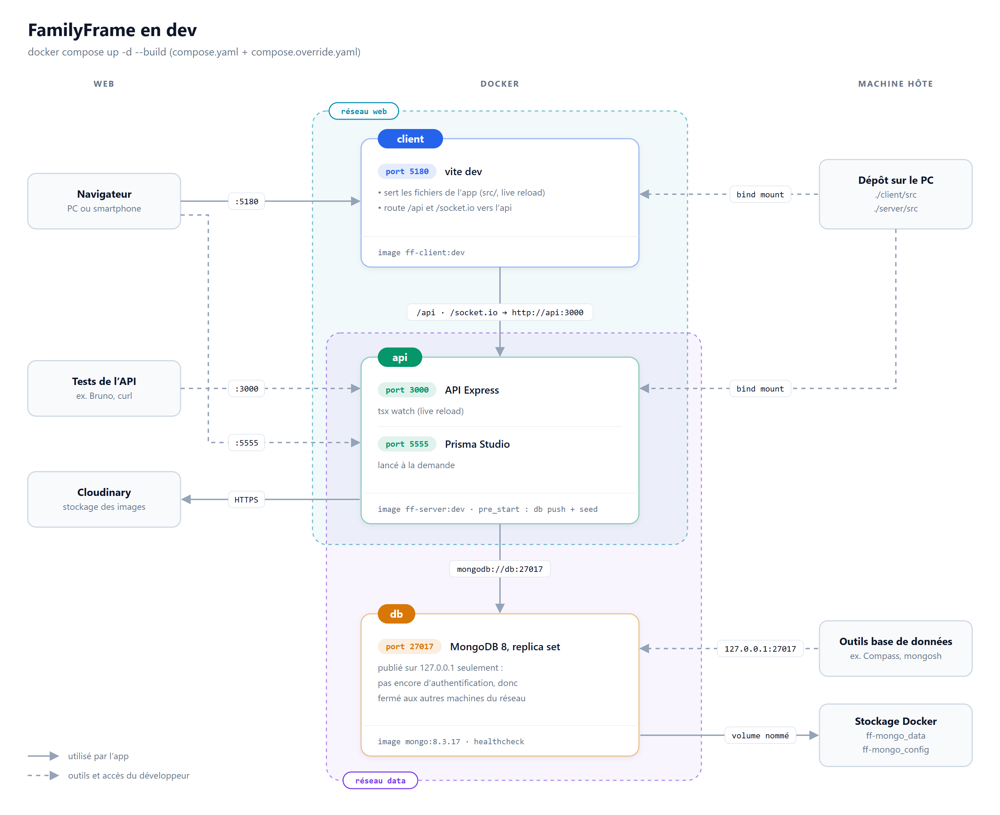
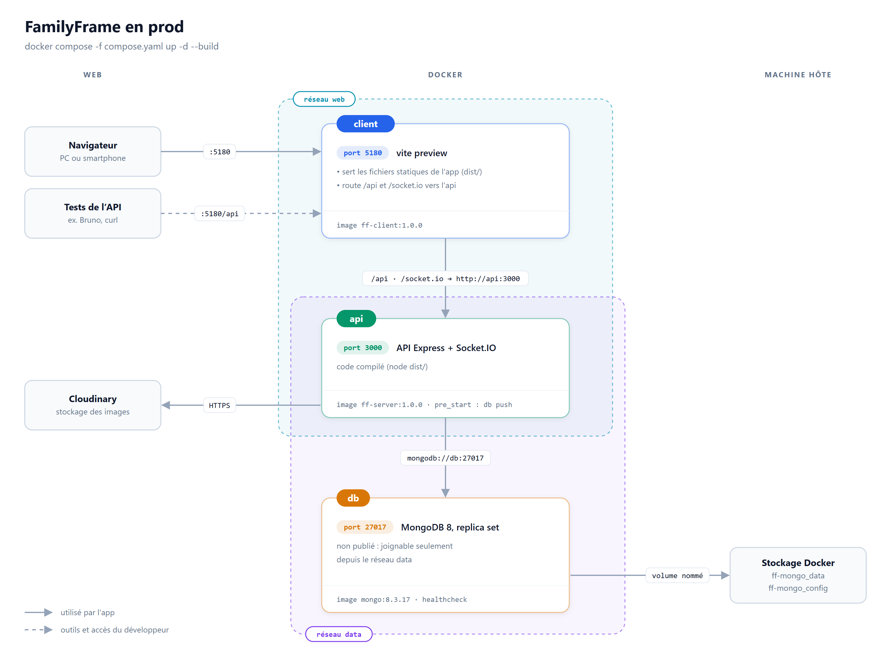

# FamilyFrame 🎄

Cadre photo connecté pour les familles éloignées : un proche se connecte à son compte, prend une photo depuis son smartphone, et elle apparaît en temps réel sur le cadre installé chez ses grands-parents — sans rechargement.

Projet de formation **Concepteur Développeur d'Applications** (Simplon), axé sur la **conteneurisation avec Docker et Docker Compose**. Énoncé complet : [`docs/brief.md`](docs/brief.md).

## Stack

| Couche   | Technologies                                        |
| -------- | --------------------------------------------------- |
| Frontend | pnpm, React, Vite                                   |
| Backend  | Node.js, Express, Socket.IO                         |
| Données  | MongoDB (container Docker ou MongoDB Atlas), Prisma |
| Images   | Multer, Sharp, Cloudinary                           |
| DevOps   | Docker, Docker Compose, CI (optionnelle)            |

Architecture, parcours d'une photo et choix techniques : [`ARCHITECTURE.md`](ARCHITECTURE.md).

Ce que l'application permet de faire et ses règles de gestion, sans détail technique : [`docs/produit/README.md`](docs/produit/README.md).

## Feuille de route

- [x] **J1** — MVP fonctionnel en local, sans Docker
- [x] **J2–J4** — Conteneurisation front/back, orchestration Docker Compose, variables d'environnement et secrets, documentation de démarrage
- [ ] **J5** — Polish UX du cadre (dernière photo en avant, historique consultable, pseudo affiché)

## Démarrage avec Docker Compose

**Prérequis :**

- Docker Desktop (Docker Compose 5.3 ou plus récent, pour `pre_start`)
- un compte Cloudinary (le serveur refuse de démarrer sans ses trois variables), avec « Strict transformations » activé dans Settings → Security (sinon un test Bruno échoue, voir [ARCHITECTURE.md](ARCHITECTURE.md))

Pas besoin de MongoDB Atlas : la base tourne dans un container.

Toutes les commandes se lancent depuis la racine du dépôt. Une seule fois, avant le premier lancement :

```bash
cp server/.env.example server/.env   # puis renseigner les 3 variables Cloudinary (DATABASE_URL est fournie par le compose)
```

Deux fichiers Compose :

- `compose.yaml` décrit la prod
- `compose.override.yaml` ajoute ce qui change en dev

Dans les deux cas, avant de démarrer l'API, son `pre_start` prépare la base : `pnpm db:push` crée les index, puis en dev seulement `pnpm db:seed --if-empty` crée les comptes de test si la base est vide.

### Lancer en dev

```bash
docker compose up -d --build
```

`docker compose up` charge les deux fichiers. On obtient :

- le live reload du client et du serveur (les dossiers `src/` sont montés dans les containers)
- une base créée et seedée avec les comptes de test au premier lancement
- Prisma Studio sur le port 5555
- la base joignable depuis la machine sur `mongodb://localhost:27017/familyframe?directConnection=true` (Compass, mongosh). Le port n'est ouvert que sur `127.0.0.1`, car la base n'a pas encore d'authentification.



### Lancer en prod

```bash
docker compose -f compose.yaml up -d --build
```

Avec `-f compose.yaml`, seul ce fichier est chargé, sans l'override. On obtient :

- des images optimisées (code compilé, dépendances de prod seulement)
- une base vide : les index sont créés, mais pas de comptes de test
- seul le port du client (5180) publié : l'API passe par son proxy (`http://localhost:5180/api`), la base n'est pas joignable



### Commandes utiles

| Commande                                                | Rôle                                                         |
| ------------------------------------------------------- | ------------------------------------------------------------ |
| `docker compose ps`                                     | état des containers et ports ouverts                         |
| `docker compose logs -f api`                            | logs de l'API en continu                                     |
| `docker compose exec api pnpm db:seed`                  | remet la base à zéro avec les comptes de test                |
| `docker compose exec api pnpm db:studio --browser none` | Prisma Studio sur http://localhost:5555 (dev seulement)      |
| `docker compose stop` / `docker compose start`          | met en pause / relance les containers                        |
| `docker compose down`                                   | supprime les containers, la base est gardée dans les volumes |
| `docker compose down -v`                                | supprime aussi les volumes : base vide au prochain lancement |

<details>
<summary>Alternative pédagogique : Docker sans Compose</summary>

Les mêmes étapes que le compose, tapées une par une avec la CLI Docker : pour comprendre ce que Compose fait à notre place. Commandes PowerShell, depuis la racine du dépôt, avec `server/.env` déjà rempli.

**0. Variables** (à refaire dans chaque nouveau terminal) : si un nom change, on le change ici seulement.

```powershell
$WEB_NETWORK           = "ff-web"
$DATA_NETWORK          = "ff-data"
$MONGO_CONTAINER_NAME  = "ff-mongo"
$SERVER_CONTAINER_NAME = "ff-server"
$CLIENT_CONTAINER_NAME = "ff-client"
```

**1. Réseaux et base** (communs au dev et à la prod)

```powershell
# deux réseaux, comme le compose : web (client + api) et data (api + base)
# sur un même réseau, les containers se trouvent par leur nom
docker network create $WEB_NETWORK
docker network create $DATA_NETWORK

# la base, en replica set (Prisma en a besoin), données gardées dans un volume nommé
# seulement sur data : le client ne peut pas la joindre
docker run -d `
  --network $DATA_NETWORK `
  --name $MONGO_CONTAINER_NAME `
  --hostname $MONGO_CONTAINER_NAME `
  -v ff-mongo_data:/data/db `
  mongo:8.3.17 `
  --replSet rs0

# créer le replica set (une seule fois)
docker exec $MONGO_CONTAINER_NAME mongosh --eval "rs.initiate()"
```

**2a. En dev** : images du stage `dev`, dossiers `src/` montés pour le live reload.

```powershell
docker build --target dev -t ff-server:dev ./server
docker build --target dev -t ff-client:dev ./client

docker run -d `
  --network $DATA_NETWORK `
  --name $SERVER_CONTAINER_NAME `
  -p 3000:3000 `
  -p 5555:5555 `
  --env-file server/.env `
  -e DATABASE_URL=mongodb://${MONGO_CONTAINER_NAME}:27017/familyframe `
  -e CHOKIDAR_USEPOLLING=true `
  -v ${PWD}/server/src:/app/src `
  ff-server:dev

# l'api fait le pont : on la branche aussi sur web, pour que le client la joigne
docker network connect $WEB_NETWORK $SERVER_CONTAINER_NAME

# ce que fait le pre_start du compose
docker exec $SERVER_CONTAINER_NAME pnpm db:push
docker exec $SERVER_CONTAINER_NAME pnpm db:seed --if-empty

docker run -d `
  --network $WEB_NETWORK `
  --name $CLIENT_CONTAINER_NAME `
  -p 5180:5180 `
  -e API_PROXY_TARGET=http://${SERVER_CONTAINER_NAME}:3000 `
  -e CHOKIDAR_USEPOLLING=true `
  -v ${PWD}/client/src:/app/src `
  ff-client:dev
```

**2b. En prod** : images du stage `main`, sans montage ni seed.

```powershell
docker build -t ff-server:1.0.0 ./server
docker build -t ff-client:1.0.0 ./client

# pas de -p : en prod, l'api se joint par le proxy du client (5180/api)
docker run -d `
  --network $DATA_NETWORK `
  --name $SERVER_CONTAINER_NAME `
  --env-file server/.env `
  -e DATABASE_URL=mongodb://${MONGO_CONTAINER_NAME}:27017/familyframe `
  ff-server:1.0.0

docker network connect $WEB_NETWORK $SERVER_CONTAINER_NAME

# ce que fait le pre_start du compose
docker exec $SERVER_CONTAINER_NAME pnpm db:push

docker run -d `
  --network $WEB_NETWORK `
  --name $CLIENT_CONTAINER_NAME `
  -p 5180:5180 `
  -e API_PROXY_TARGET=http://${SERVER_CONTAINER_NAME}:3000 `
  ff-client:1.0.0
```

Sans `--target`, `docker build` prend le dernier stage du Dockerfile (`main`).

**3. Arrêter et nettoyer**

```powershell
docker stop $CLIENT_CONTAINER_NAME $SERVER_CONTAINER_NAME $MONGO_CONTAINER_NAME
docker container rm $CLIENT_CONTAINER_NAME $SERVER_CONTAINER_NAME $MONGO_CONTAINER_NAME
docker network rm $WEB_NETWORK $DATA_NETWORK
# docker volume rm ff-mongo_data   # seulement pour repartir d'une base vide
```

</details>

## Démarrage sans Docker

**Prérequis :**

- Node.js ≥ 24 (voir `.nvmrc`)
- pnpm 10 (`corepack enable`)
- un cluster MongoDB Atlas
- le compte Cloudinary décrit plus haut

```bash
pnpm install                         # installe tout le workspace + génère le client Prisma
cp server/.env.example server/.env   # puis renseigner DATABASE_URL et les 3 variables Cloudinary
pnpm db:push                         # crée les collections et les index dans MongoDB
pnpm db:seed                         # vide la base et crée les deux comptes de test
pnpm dev                             # lance client et serveur en parallèle
```

## Accès

### Ports

| Service       | URL                   | Quand               |
| ------------- | --------------------- | ------------------- |
| Client (Vite) | http://localhost:5180 | toujours            |
| API (Express) | http://localhost:3000 | dev                 |
| Prisma Studio | http://localhost:5555 | dev, une fois lancé |
| MongoDB       | `localhost:27017`     | dev avec Docker     |

Depuis un smartphone sur le même réseau : `http://<ip-du-pc>:5180`. Il faut que :

- le pare-feu Windows autorise Docker (ou Node, sans Docker) sur les réseaux privés
- le Wi-Fi n'isole pas les appareils entre eux

Un lien d'invitation reprend l'adresse de la page où il est créé : le créer depuis `http://<ip-du-pc>:5180`, pas depuis `localhost`.

### Comptes de test

Créés par le seed (**développement uniquement**, mots de passe publics) :

| Rôle   | E-mail                    | Mot de passe             |
| ------ | ------------------------- | ------------------------ |
| admin  | `admin@familyframe.test`  | `admin-familyframe-dev`  |
| membre | `membre@familyframe.test` | `membre-familyframe-dev` |

Le seed efface toutes les photos, sessions et comptes avant de recréer ces deux comptes (les images restent sur Cloudinary, sans référence). Il refuse de tourner avec `NODE_ENV=production`.

Quand le schéma change sur une base qui contient déjà des photos, un nouvel index unique peut refuser de se créer. Il faut alors vider la base avant de pousser le schéma :

- avec Docker : `docker compose down -v`, puis relancer
- sans Docker : `pnpm db:seed` **avant** `pnpm db:push`

### Utilisation

| Service       | URL                                     |
| ------------- | --------------------------------------- |
| Connexion     | http://localhost:5180/login             |
| Bibliothèque  | http://localhost:5180                   |
| Cadre         | http://localhost:5180/frame             |
| Amis          | http://localhost:5180/friends           |
| Préférences   | http://localhost:5180/settings          |
| Invitations   | http://localhost:5180/admin/invitations |

Sans session, la bibliothèque et le cadre redirigent vers `/login` ; le cadre se connecte une fois avec un compte et reste connecté tant qu'il est allumé : il recharge ses photos chaque jour, ce qui prolonge la session glissante de 90 jours.

Le cadre (`/frame`) n'affiche que le diaporama : « Mode cadre » le lance en plein écran depuis la bibliothèque ou depuis une photo ouverte ; ✕, Échap ou la sortie du plein écran ramènent à la bibliothèque sur la photo qui était à l'écran. Son menu « … » règle le modèle d'affichage, l'ordre de lecture et la vitesse, retenus par appareil ; on les retrouve dans « Préférences », encart « Cadre de cet appareil ».

Regarder ses photos : dans la bibliothèque, toucher une photo l'ouvre en grand ; balayer ou utiliser les flèches pour passer à la suivante, ✕ ou Échap pour revenir.

Inviter un proche : connecté en admin, ouvrir « Invitations » depuis la bibliothèque, saisir son e-mail et transmettre soi-même le lien obtenu (message, SMS : l'application n'envoie pas d'e-mail). Le lien sert une seule fois, pendant 7 jours ; il ouvre une page où la personne choisit son nom et son mot de passe. Créer les liens depuis l'adresse que la famille utilise (`http://<ip-du-pc>:5180` sur le réseau local), pas depuis `localhost` : le lien reprend l'adresse de la page. Réinviter le même e-mail remplace l'ancien lien.

Ajouter un ami : ouvrir « Amis » depuis la bibliothèque et saisir l'adresse e-mail exacte de son compte FamilyFrame (la personne doit déjà avoir un compte : sinon, demander une invitation à l'admin). Elle voit la demande sous « Demandes reçues » et l'accepte ou la refuse ; une fois acceptée, chacun peut retirer l'autre. Les listes ne se mettent pas à jour toutes seules : recharger la page pour voir la réponse de l'autre.

Envoyer une photo à un ami : dans la bibliothèque ou sur le cadre, le menu « … » d'une photo propose « Envoyer à un ami » ; dans la carte d'envoi, choisir un fichier puis « Envoyer à un ami » plutôt que « Ajouter à ma bibliothèque ». Le panneau « Envoyer à des proches » montre les amis acceptés : toucher ceux qui doivent la recevoir, puis « Envoyer à N personnes » ; une notification confirme à qui elle est partie. Un message facultatif (200 caractères au plus) peut l'accompagner. La photo n'entre que chez l'ami, comme une lettre non ouverte : sa bibliothèque annonce « Vous avez 1 nouvelle photo », et « Découvrir » la montre en grand avec « Envoyée par », votre nom et votre message, avant qu'elle rejoigne sa bibliothèque et son cadre. Chacun supprime ses photos de son côté : retirer l'ami ou supprimer l'original ne retire pas la photo reçue.

Modifier son compte : « Préférences », dans le menu du compte (l'avatar en haut à droite, ou ☰ sur mobile). Chaque carte de compte a son « Enregistrer » : photo de profil (JPEG, PNG ou WebP, recadrée en carré), nom affiché et mot de passe ; la carte « Cadre de cet appareil » s'applique dès qu'on choisit. L'adresse e-mail ne se modifie pas encore. Changer de mot de passe déconnecte les autres appareils du compte : le cadre revient à la page de connexion à son prochain rechargement des photos (au plus tard le lendemain) ou à sa prochaine reconnexion ; s'y reconnecter avec le nouveau mot de passe.

## Scripts racine

À lancer sur la machine, depuis la racine du dépôt (après `pnpm install`).

Raccourcis Docker (les vraies commandes sont expliquées dans [Démarrage avec Docker Compose](#démarrage-avec-docker-compose)) :

| Script               | Commande lancée                                         |
| -------------------- | ------------------------------------------------------- |
| `pnpm docker:dev`    | `docker compose up -d --build`                          |
| `pnpm docker:prod`   | `docker compose -f compose.yaml up -d --build`          |
| `pnpm docker:down`   | `docker compose down`                                   |
| `pnpm docker:logs`   | `docker compose logs -f api`                            |
| `pnpm docker:seed`   | `docker compose exec api pnpm db:seed`                  |
| `pnpm docker:studio` | `docker compose exec api pnpm db:studio --browser none` |

Outils de code, utilisables que l'app tourne dans Docker ou non :

| Script                          | Rôle                                    |
| ------------------------------- | --------------------------------------- |
| `pnpm typecheck`                | vérification TypeScript                 |
| `pnpm check` / `pnpm check:fix` | lint + format + tri des imports (Biome) |
| `pnpm test`                     | tests unitaires du serveur (Vitest)     |
| `pnpm test:hooks`               | tests des hooks Claude Code             |
| `pnpm test:bruno`               | requêtes Bruno contre l'API lancée      |
| `pnpm test:bruno:prod`          | requêtes Bruno sans compte, via 5180    |

Sans Docker seulement (ils utilisent le `DATABASE_URL` de `server/.env`, pas la base du container) :

| Script           | Rôle                                                            |
| ---------------- | --------------------------------------------------------------- |
| `pnpm dev`       | client + serveur en mode watch                                  |
| `pnpm build`     | build des deux packages                                         |
| `pnpm db:push`   | synchronise le schéma Prisma avec MongoDB                       |
| `pnpm db:seed`   | vide la base et crée les comptes de test (refusé en production) |
| `pnpm db:studio` | explorateur de données Prisma Studio                            |

## Contribuer

Git flow, conventions de commit et de PR : voir [`CONTRIBUTING.md`](CONTRIBUTING.md).
